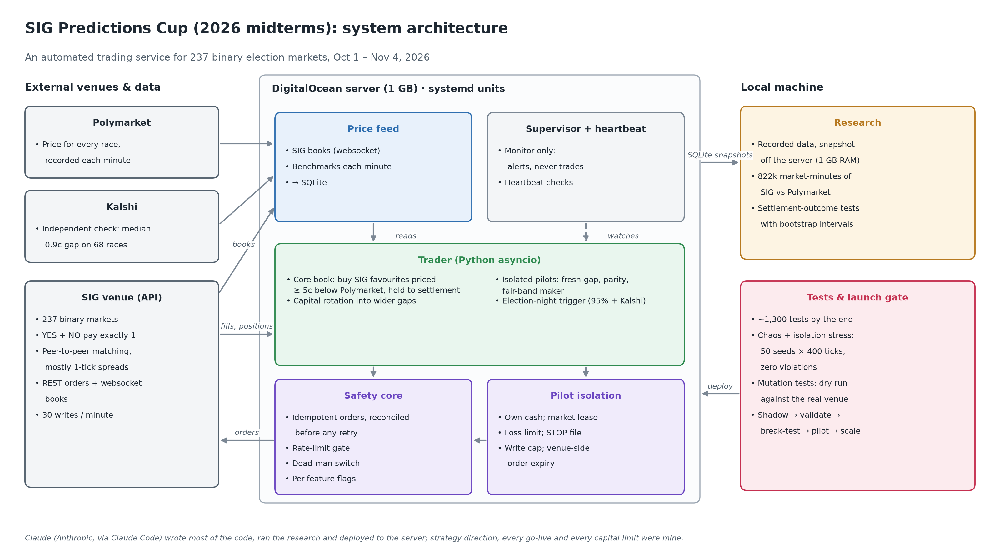

# SIG Predictions Cup (2026 midterms): an automated trading bot

**+$8,849 on a 100,000 start, rank 557 of 5,141 participants (top 11%)** in Susquehanna's (SIG's) simulated prediction-market tournament on the 2026 US midterms (provisional until the last markets settle). I built and ran a fully automated trading service across 237 binary election markets from Oct 1 to Nov 4, 2026. Claude (Anthropic's model, through Claude Code) wrote the code.

- **The edge:** SIG's crowd underpriced favourites against Polymarket and Kalshi. Bought on SIG and held to settlement, they made **+10.9c per share on 77 markets** (90% interval +6.5c to +15.0c).
- **The failure:** I lost $15k in launch week by putting features live before testing them.
- **The fix:** a shadow → validate → break-test → small isolated pilot → scale process. After it, no bug cost capital, and the account climbed +$21k from the trough.

## Read the write-up
- [One-page version](writeup/README.md)
- [Summary (3–4 pages)](writeup/summary.md)
- [Complete write-up](writeup/technical.md): every strategy, incident and study, with appendices

## What's in this repo

| Folder | What it is |
|---|---|
| `sig/` | Venue adapter (REST client, write gate for 30 writes/min, order management, websocket feed) and the engine: orchestrator, core book, rotation, isolated pilots, election night |
| `strategies/` | Strategy building blocks: sizing, risk gate, exits, allocator, and the retired market-making and arbitrage strategies |
| `signals/` | Benchmarks and signals: Polymarket and Kalshi clients, race mapping, fair value, Wikipedia ratings |
| `infra/` | Safety core: idempotent orders, reconciliation, dead-man switch, alerting, state store |
| `api/` | Health sidecar |
| `deploy/` | systemd units and the deploy guide |
| `config/` | Configuration, every feature behind a flag |
| `tests/` | About 1,300 tests, including chaos, isolation and mutation tests |
| `tools/`, `recon/`, `docs/research/` | Research scripts and studies run on recorded data |
| `docs/specs/`, `docs/strategies/` | Design specs and strategy notes |
| `docs/DESIGN.md` | The original design overview |
| `writeup/` | The write-ups, figures and the scripts that made them |

The recorded market data and the bot's database aren't included.
