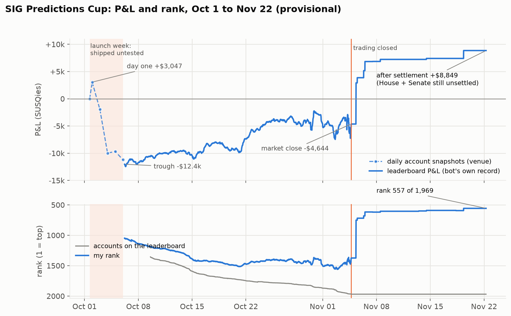
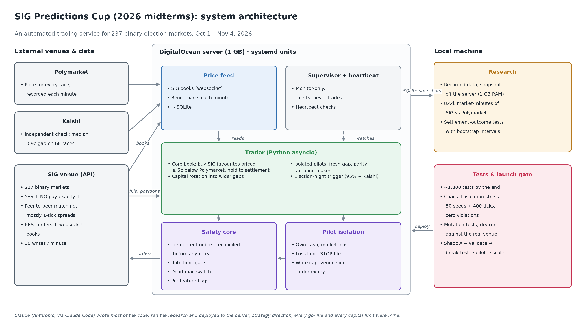
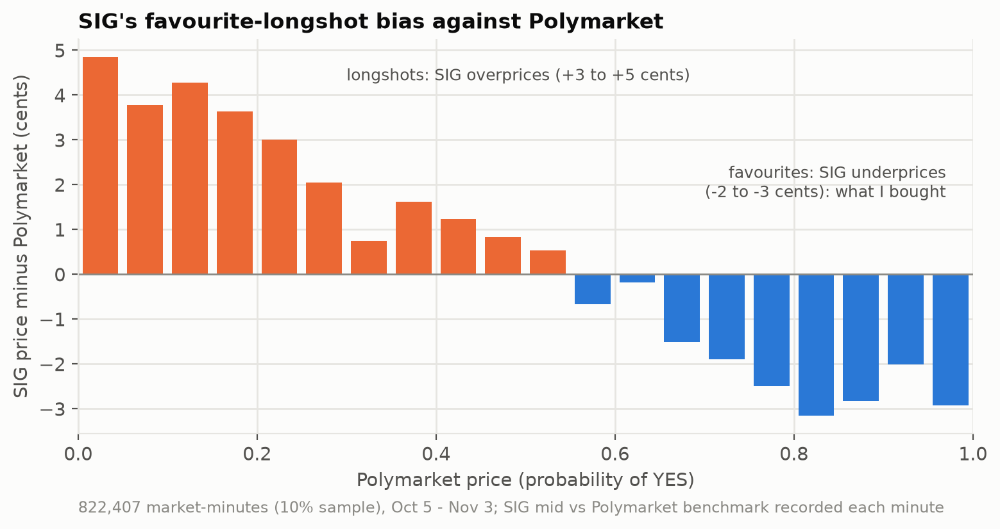

# SIG Predictions Cup (2026 midterms): a trading bot, a bad first week, and the climb back

> **Provisional (as of 2026-11-22).** Two markets, House and Senate control, are closed but not yet settled. Those positions are marked at $7,917; if both settle YES they pay $8,552, which would make the final P&L about **+$9,484**. The rank can still move. Every number marked <!-- UPDATE --> changes at settlement.

**Result so far: +$8,849 on a 100,000 start, rank 557 of 5,141 participants (top 11%).** <!-- UPDATE --> The leaderboard lists only the 1,969 accounts that traded, and everyone ahead of me is among them, so the rank holds across all 5,141 who joined.

## The short version
- **The competition:** SIG's simulated trading tournament on the 2026 US midterms. 237 binary markets (Senate, House, governors, chamber control), 100,000 SUSQies each, Oct 1 to Nov 4. Bots were allowed through the official API. The score is the balance after every market settles, so marks during the month don't count.
- **The edge:** SIG's crowd overpriced longshots and underpriced favourites against Polymarket and Kalshi, by about 2–3 cents on favourites. The core of my bot bought SIG favourites priced below Polymarket and held them to settlement. That book held 90–95% of capital and produced almost the whole final score.
- **The failure:** I finished day one at +$3,047, around rank 70 of ~700 by my recollection (the venue keeps no past leaderboards). Then I lost it in a week by putting features live before testing them. An untested exit kept re-buying positions the bot didn't know it held, an untested Wikipedia benchmark aimed it at ~100 more markets the same evening, and strategies traded against each other. The trough was −$12.4k on Oct 5.
- **The climb back:** from Oct 6, every feature went shadow, then validate, then break-test, then a small isolated pilot, and only then scale. No further large losses. **+$21.3k from the trough** <!-- UPDATE -->, most of it arriving at settlement, when favourites bought at 85–93 cents paid out at 1.00.

## How it was built

A Python asyncio service on a 1 GB server: a websocket price feed into SQLite, a trader whose every order goes through a safety core, hard isolation for each live pilot, and a monitor-only supervisor. Research and the test suite (about 1,300 tests) ran locally on snapshots of the bot's database.

## What I'd show someone in five minutes
1. **The bias was real, and it paid at settlement:** 822k market-minutes of SIG vs Polymarket prices (figure above). Held to settlement, the core rule made +10.9 cents a share on favourites (77 markets, 90% interval +6.5 to +15.0).
2. **The order log of my worst night,** minute by minute: an exit re-buying in doubling sizes (161 → 322 → 644 → 1,288 → 2,576 → 3,232 shares) six minutes *before* the Wikipedia feed went live. The feed didn't cause the bug, but it pointed the bug at ~100 more markets.
3. **The process change that ended it.** The first pilot built under the new process passed 24 happy-path tests and still had 4 critical bugs (a double buy, an oversell, a lease lapse, a crash on a stale price). The break-test caught all four before they touched capital.
4. **Where the final score came from.** Settlement batches turned −$4,644 at close into +$8,849, with +$7,557 in the first batch alone. Daily Sharpe from Oct 6 to close was 4.2; counting launch week it was −1.1 ([numbers](technical.md#35-the-results-in-numbers)).
5. **An election-night trader built from data.** A replay of 2024 election night set the trigger at 95% (90% had false calls). An automated sell-down raised $40k of cash in 21 minutes, and the trader filled 22 races at an average of 93 cents.

## Tools and roles
I built and ran the bot with Claude (Anthropic's model, through Claude Code) as my engineering partner. Claude wrote most of the code, ran the research on recorded data, deployed to the server and kept the journal.

My part:
- the strategy direction and the decisions to go live or not;
- the capital limits (for example, $40k for election night);
- the rule set that ended the slide (shadow, validate, break-test, pilot).

## Read more
- [Summary](summary.md) (3–4 pages): the edge, the launch-week failure, the fix, election night and lessons.
- [Complete write-up](technical.md): everything, including the settlement analysis of every strategy and dropped idea, plus appendices with the full timeline, every risk control, testing, every incident and 60+ research studies.
- [Figures](figures/), made by [make_figures.py](make_figures.py) from read-only exports of the bot's database. The architecture diagram is drawn by [make_diagrams.py](make_diagrams.py) from the system's design, not from data.
