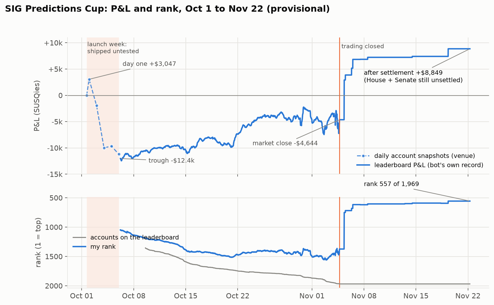
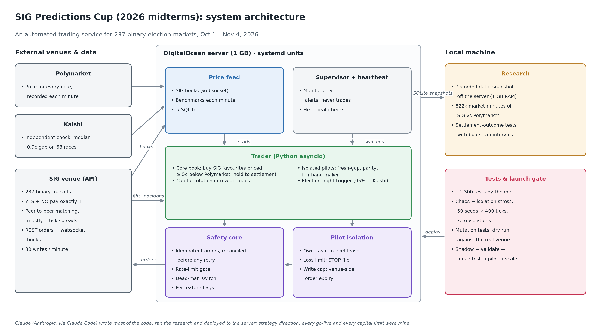
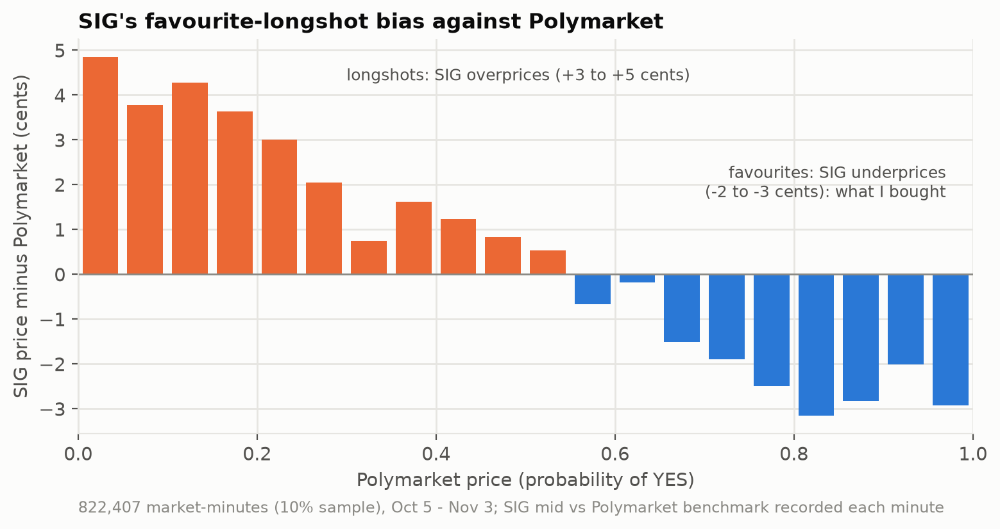
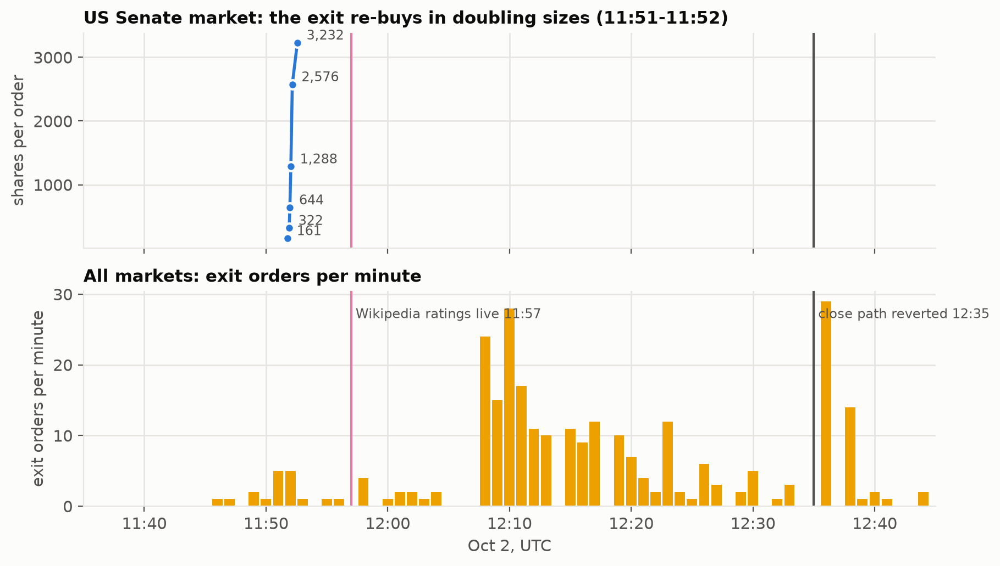
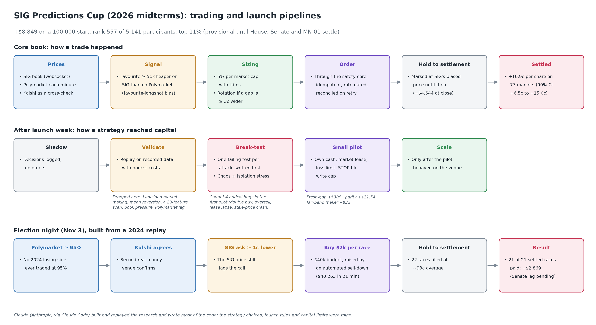

# SIG Predictions Cup (2026 midterms): summary

> **Provisional (as of 2026-11-22).** House and Senate control are closed but not yet settled. If both settle YES, the final P&L is about **+$9,484**. Numbers marked <!-- UPDATE --> change at settlement.

**Result so far: +$8,849 on a 100,000 start, rank 557 of 5,141 participants (top 11%).** <!-- UPDATE --> I built and ran an automated trading bot through the whole tournament, with Claude (Anthropic's model, through Claude Code) as my engineering partner.

This is the middle-length version. [README.md](README.md) is the one-page version; [technical.md](technical.md) has everything, including every study, incident and number.

## 1. The competition

- **Format:** SIG's simulated trading tournament on the 2026 US midterms: 237 binary markets (Senate, House, governors and chamber control), 100,000 play-money SUSQies per account, Oct 1 to Nov 4. Bots were allowed through the official API.
- **Scoring:** the balance after every market settles. Marks during the month don't count, only what positions pay at settlement.
- **Mechanics that mattered:**
  - YES and NO pay exactly 1 together.
  - Matching is peer-to-peer, so a limit order fills only against a resting order.
  - Most books have 1-tick spreads.
  - Accounts get 30 writes a minute.

## 2. What I built

- **System:** a Python (asyncio) service on a 1 GB DigitalOcean server, run as systemd units:
  - the trader;
  - a websocket price feed into SQLite;
  - a monitor-only supervisor and a heartbeat.
- **Safety core** (ported from an earlier stock-trading bot of mine):
  - idempotent orders, reconciled before any retry of an ambiguous response;
  - a dead-man switch and a rate-limit gate;
  - a per-feature flag for everything.
- **Benchmarks:** Polymarket prices for every race, recorded each minute. Kalshi served as an independent check; the two agreed within a median 0.9 cents on 68 shared races.
- **Isolation for live experiments:** each pilot strategy got:
  - its own cash, and exclusive ownership of its markets through a lease;
  - a loss limit, a STOP file and a write cap;
  - venue-side order expiry.

  No pilot could sell another strategy's inventory.
- **Testing:** the suite grew to about 1,300 tests by the end. It includes chaos and isolation stress tests (50 seeds × 400 ticks, zero violations), mutation tests, and a dry run against the real venue.

## 3. The edge: SIG's favourite-longshot bias

SIG's crowd **overpriced longshots and underpriced favourites** against Polymarket and Kalshi. Across 822k market-minutes, favourites traded 1.5–3 cents below Polymarket and longshots 2–5 cents above.

- **Was the benchmark right?** Claude checked 2024 data first: favourites won 93% of the time at an average Polymarket price of 85%.
- **The core strategy:** buy the favoured side when SIG sat at least 5 cents below Polymarket, and hold to settlement. It held 90–95% of capital most of the month.

**Tested against the actual outcomes** (official settlement, each market counted once, 90% bootstrap intervals):

| Rule | Markets | Profit per share | 90% interval |
|---|---|---|---|
| Core: buy the favourite when SIG is ≥ 5c below Polymarket | 77 | **+10.9c** | +6.5c to +15.0c |
| Core: buy NO on a longshot SIG prices ≥ 5c above Polymarket | 87 | **+6.5c** | +1.7c to +11.2c |
| Buy every SIG longshot (< 30%) | 92 | −6.4c | −10.7c to −1.9c |

The caveat: this is one election, so outcomes are correlated. Democratic favourites won 45 of 45 and Republican favourites 27 of 32. The sign of the edge is solid; its size is partly the national swing.

**Where the score came from.** The leaderboard marked my favourites at SIG's own biased prices all month, so the account showed negative until settlement:
- **−$4,644** at market close (rank 1,374);
- then settlement batches added **+$13,493**, reconciling exactly to +$8,849;
- the first batch alone (109 markets, Nov 5) added +$7,557.

| Window | Daily Sharpe (annualised) | Max drawdown |
|---|---|---|
| Oct 6 to market close (after launch week) | 4.24 | −5.3% |
| Oct 1 to market close (including launch week) | **−1.09** | −14.3% |

The figure that includes launch week is the honest one. The venue's own figure (−1.52) agrees.

## 4. Launch week: how I lost $15k in four days

I finished day one at **+$3,047**. By Oct 5 the account was at **−$12,439** (rank 972 of 1,149).

The ideas weren't the problem. **I let features go live before anything tested them against the real venue.** The server's git history shows 84 commits on Oct 2 alone, many of them fixes to things that had just gone live.

- **An untested exit re-bought instead of closing.** The venue's `option` field always says "YES". So the bot read its NO positions as longs, decided its thesis had reversed, sold, and re-bought: 905 exits on one market. On the US Senate market it bought in doubling sizes within a minute: 161 → 322 → 644 → 1,288 → 2,576 → 3,232 shares.
- **A second untested feature went live the same evening.** Wikipedia race ratings, wired in as a benchmark, gave about 100 more markets a "signal" eleven minutes after launch, and the broken exit fired on all of them. The runaway started six minutes before Wikipedia went live, so Wikipedia didn't cause the bug, but it multiplied it.
- **Strategies traded against each other:**
  - market making sold about $45k of the core book at a 2-cent discount;
  - a "sniper" kept re-firing taker orders into the same gaps;
  - 3,248 stale orders piled up.
- **The sizing was aggressive:** about full Kelly on the core edge, a 12% per-market cap, and no cash reserve. By Oct 5 the top five positions held about 65% of NAV.

The two worst days cost $5.0k and $8.0k. Over the week the bot traded $3.2M of volume, about 10x a typical top-10% account, at negative edge.

## 5. The fix: a launch process, and the climb back

On Oct 5–6, Claude rebuilt the project's state from the repo and the live server only, and did a full code read against the real venue mechanics. The fixes:
- the exit was fixed;
- market making and the sniper were retired;
- a 5% per-market cap with trims was added.

Then I made a rule for everything after: **shadow → validate on recorded data with honest costs → break-test adversarially (a failing test first for each attack) → small isolated pilot → scale.**

- **It caught real bugs.** The first pilot built under the new process passed 24 happy-path tests and still had four critical bugs: a double buy, an oversell, a lease lapse, and a crash on a stale price. The break-test found all four before they touched capital.
- **Bugs kept appearing afterwards,** for example a 39-minute stall and a false loss halt, but none of them cost capital.

**What ran live after the reset:**

| Strategy | Idea | Result |
|---|---|---|
| Core book | Buy SIG favourites priced below Polymarket, hold to settlement | Almost the whole final score |
| Capital rotation | Swap the lowest-edge holdings into higher-edge gaps (≥ 3c better) | About 40 swaps moving roughly $40k by Oct 29, marked +$1,848 |
| Fresh-gap pilot | Fade a new ≥ 3c move away from Polymarket | +$308 |
| Parity pilot | Buy both parties' NO when the YES bids sum to ≥ 1.02 | +$11.54 over 20 closed (exits rarer than the shadow suggested) |
| Fair-band maker | Join-only quotes around Polymarket's price | −$32; disfavoured quotes never fill |

**Dropped after testing on recorded data:**
- two-sided market making (loses $1–14k a day in simulation);
- mean reversion (moves toward Polymarket keep going);
- a 23-feature short-horizon scan over 2M market-minutes;
- book-pressure signals;
- a Polymarket-led lag signal (negative at every lookback).

From the trough the account climbed **+$21.3k**, most of it at settlement. <!-- UPDATE -->

## 6. Election night: built from data, run as designed

- **The data:** Claude replayed Polymarket on 2024 election night.
  - No losing side ever traded at 95%.
  - At a 90% trigger, two false calls would have wiped out the gains.
- **The rule:** buy when Polymarket crosses 95%, Kalshi agrees, and SIG's ask is at least 1 cent lower; $2k per race, held to settlement.
- **Rehearsal and cash:** the trader ran dry for three weeks. I set a $40k budget, and an automated sell-down raised $40,263 in 21 minutes on Nov 1.
- **On the night:** 61 races triggered and 22 filled at an average of 93 cents. All 21 settled races paid YES: **+$2,869**, with the Senate leg pending (+$105). <!-- UPDATE -->

## 7. What I'd do differently

- **I set a goal my strategy couldn't reach.** On Oct 6 I set a top-10% goal; the final cutoff was +$29.8k. My one edge earns about 10% per turn on about $90k of capital locked until settlement, so roughly +$10k. Reaching the goal needed a convex bet, and Claude proposed one ($7–14k on Republican Senate control). I declined it, and *ex post* it would have lost. But I never resolved the mismatch between the goal and the book.
- **I'd also hedge my national-swing exposure.** The book paid $74k if every race went Democrat and $27k if every race went Republican. A ~$3.5k hedge would have removed most of that risk at about zero expected cost. I didn't take it; it would have expired worthless.

## 8. Lessons

1. **My failure mode was launching untested, not bad ideas.** The core idea was right on day one; the code around it wasn't.
2. **Shadow, validate, break-test, small pilot, then scale.** After I adopted that, bugs hit small isolated pilots instead of the book.
3. **Only real money is a benchmark.** Ratings and models aren't prices.
4. **Find the structural bias.** The favourite-longshot gap was the only edge that scaled; everything else was cents.
5. **Validate against what you're scored on.** Settlement outcomes, not 60-minute markouts, showed the edge clearly.
6. **Match the book to the objective.** A winner-take-all tournament rewards variance near the top; decide on day one whether you're playing for that.

## Roles

- **Claude:** wrote most of the code, ran the research on recorded data, deployed to the server and kept the journal.
- **Me:**
  - the strategy direction;
  - every go-live decision and capital limit;
  - the launch rules that ended the slide.
