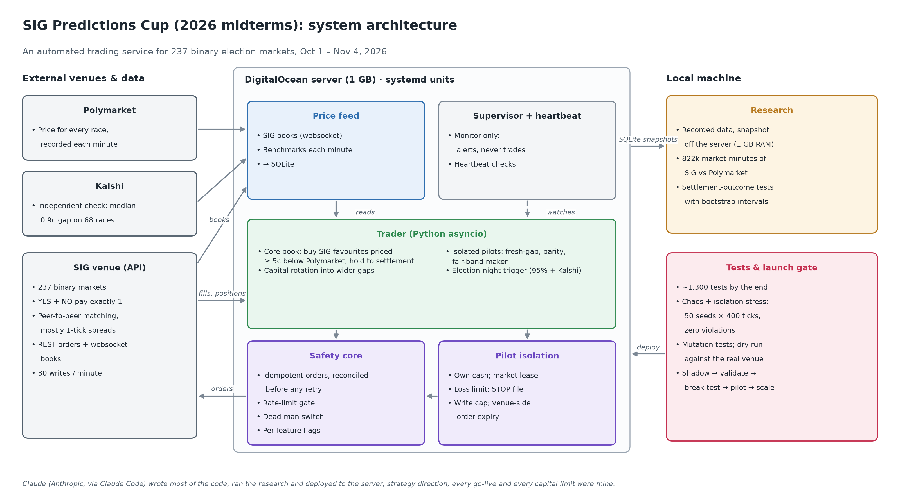
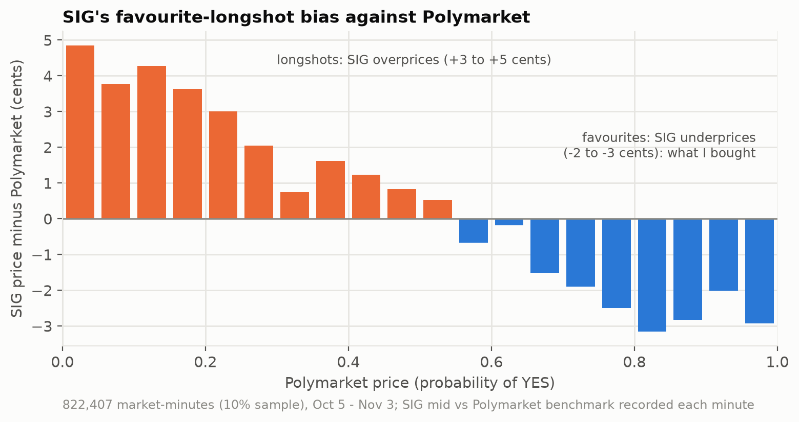
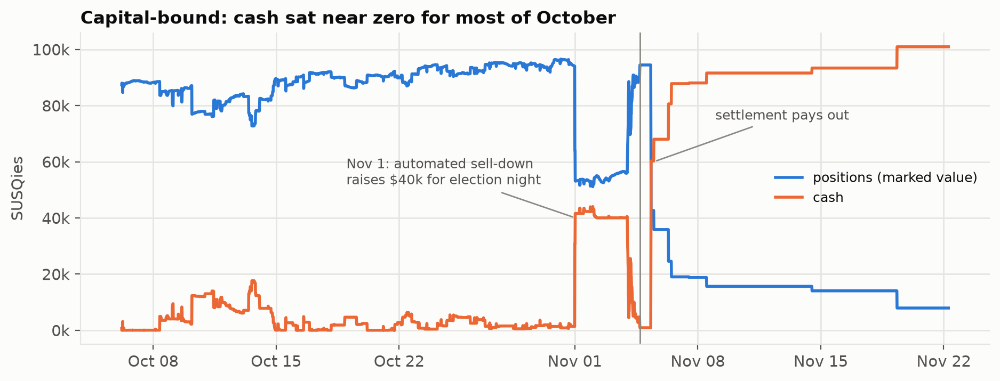
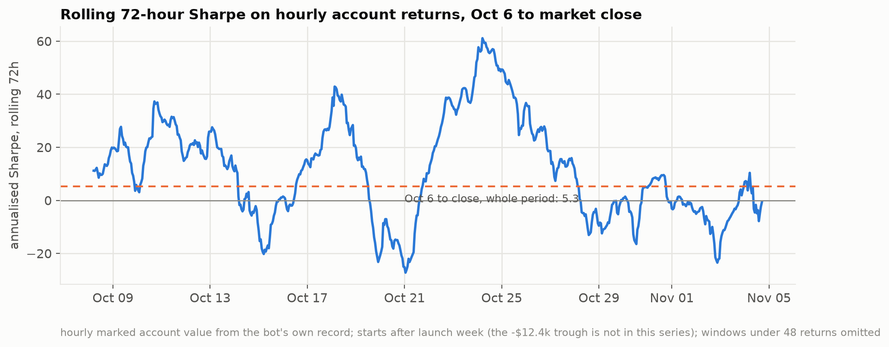
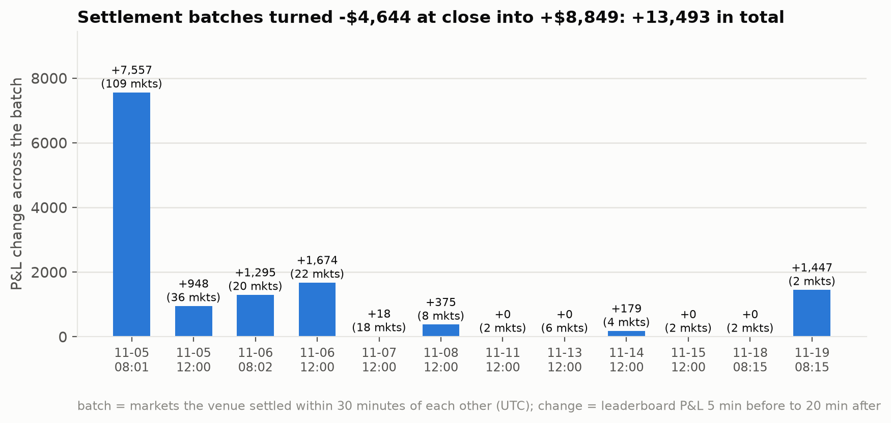
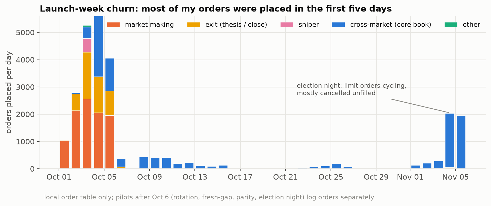
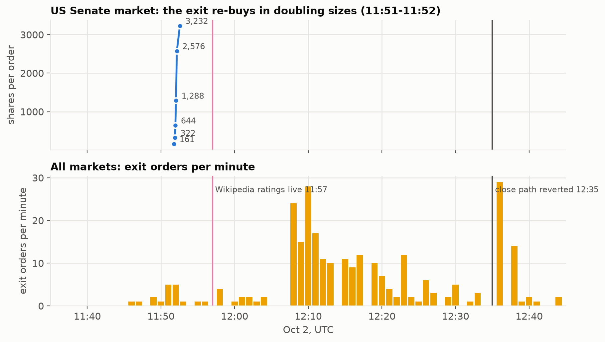
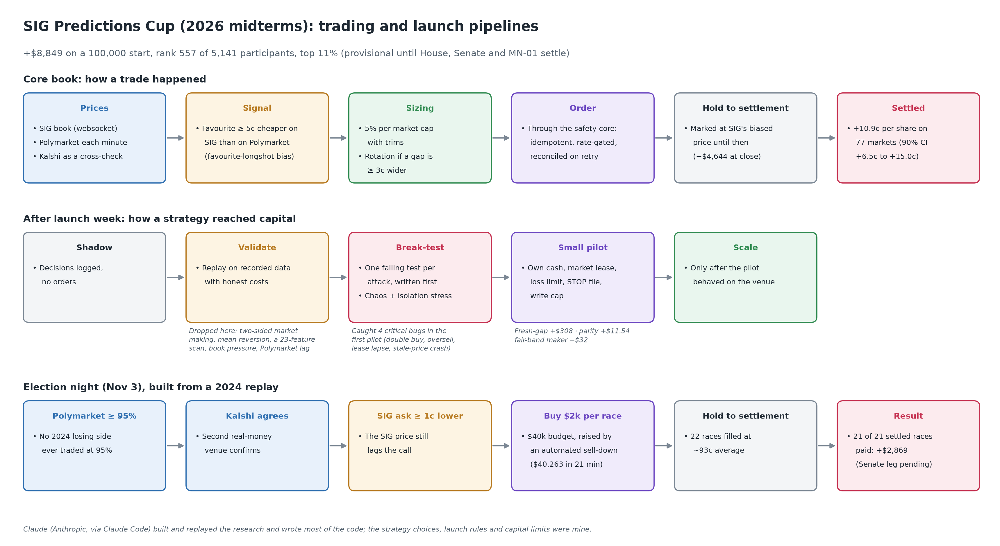
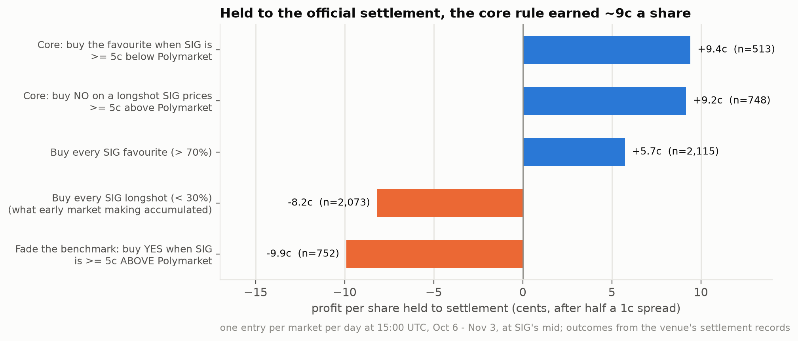
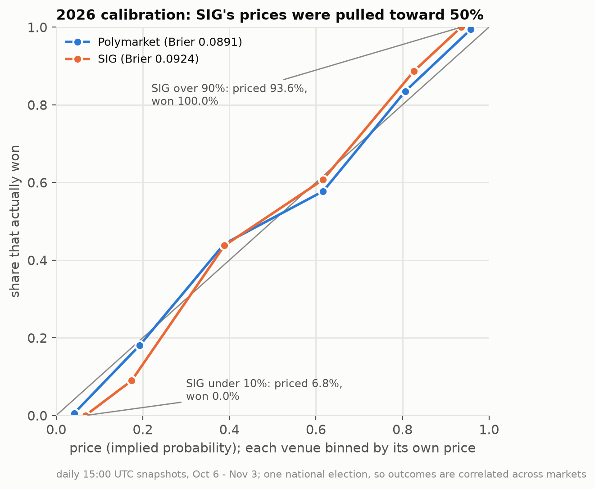

# SIG Predictions Cup: complete write-up

> **Provisional (as of 2026-11-22).** House and Senate control are closed but unsettled. I hold 6,447 YES on "Democrats win the House" and 2,105 YES on "Democrats win the Senate", marked at $7,917. If both settle YES they pay $8,552, and the final P&L would be about **+$9,484**. Lines marked <!-- UPDATE --> change at settlement; the checklist at the end lists them.

**Result so far: +$8,849 total P&L, rank 557 of 5,141 participants (top 11%).** <!-- UPDATE -->

**The path:**
- **End of day one (Oct 1): +$3,047,** from the venue's own account history. By my recollection that was around rank 70 of ~700; the venue keeps no past leaderboards.
- **The trough (Oct 5): −$12,439,** rank 972 of 1,149. The worst reading ever recorded was −$12,444.
- **Market close (Nov 4 17:00Z): −$4,644,** rank 1,374.
- **After settlement (Nov 5–19): +$8,849,** rank 557. <!-- UPDATE -->

**How I worked.** I built and ran the bot with Claude (Anthropic's model, through Claude Code) as my engineering partner.
- **Claude's part:** writing most of the code, running research on recorded data, deploying to the server, and keeping the journal.
- **My part:** the strategy direction, every go-live decision, the capital limits, and the launch rules that ended the slide.

Where something was Claude's analysis or proposal, I say so.

[One-page version](README.md) · [Summary (3–4 pages)](summary.md)

This is the complete version: everything I built, tested, broke and dropped, with the full record in the appendices.

---

## 1. The competition

- **Venue:** the SIG Predictions Cup on `thesuper.market`, tournament `midterm-elections`.
  - 237 binary markets on the 2026 US midterms: Senate, House and governor races, plus chamber control.
  - Ran 2026-10-01 16:00Z to 2026-11-04 17:00Z.
  - Every account started with 100,000 SUSQies (play money).
- **Score:** the total balance after every market resolves. **Settlement value counts; marks don't.** Prizes for the top 3. Bots and the API were explicitly allowed, one account each.
- **Mechanics that shaped everything:**
  - YES + NO pay exactly 1, so selling YES at p is the same venue order as buying NO at 1 − p.
  - Buying the opposite side cancels held shares and pays 1 per cancelled pair immediately.
  - Matching is peer-to-peer: an order fills only against a resting order, so thin books mean unfilled limits.
  - Most markets have 1-tick spreads.
  - The account limit is 30 writes per minute, plus a shared rate-limit budget for reads.
- **About the leaderboard size:** the API reports 5,141 members, but the leaderboard lists only accounts that placed at least one trade: 1,969, frozen since trading closed.
  - It isn't cut at zero: the bottom sits near −$99,999, and P&L crosses zero around rank 1,100.
  - The board grew from 1,149 (Oct 5) to 1,969 as late starters made their first trades. That's why my rank number got worse in October even as my P&L improved (figure 1, lower panel).

## 2. The bot

- **Structure:** a standalone Python service on a small DigitalOcean server, with four systemd units:
  - the trader;
  - a websocket price feed into SQLite;
  - a monitor-only supervisor;
  - a heartbeat.
- **Safety skeleton,** ported from an earlier stock-trading bot of mine:
  - idempotent order placement, and reconciliation before retrying an ambiguous response;
  - a dead-man switch and alerting;
  - a 429 / Retry-After handler and an outbound write gate.
- **Configuration:** a committed simulation-safe config plus a live overlay kept only on the server. Every feature has its own flag.
- **Isolation for live pilots:** each pilot gets:
  - its own cash carve-out, and exclusive ownership of its markets through a heartbeat lease;
  - a loss limit, a STOP file and a write cap;
  - venue-side order expiry.

  No pilot can sell another strategy's inventory.
- **Stack:**
  - Python with asyncio, httpx and websockets, and SQLite for all state;
  - structlog, plus a FastAPI health sidecar;
  - systemd units under flock, on a 1-core, 1 GB DigitalOcean server;
  - numpy, pandas and LightGBM for research, run on my laptop because the server would run out of memory.
- **Scale:**
  - 45,856 orders and 36,584 fills by Oct 9;
  - a recorded tape of 153k trades;
  - 2M market-minutes of SIG and Polymarket prices;
  - 217 race legs mapped to Polymarket, plus a Kalshi shadow on 159 legs.
- **Testing:**
  - the suite grew from 833 tests (Oct 6) to 1,333 (Oct 29);
  - an isolation stress test: 50 seeds × 400 ticks, zero violations;
  - a hostile-venue chaos test that injects 429s on 20–25% of reads;
  - a mutation test: 26 of 40 seeds fail with the fixes removed;
  - dry runs against the real venue with writes intercepted;
  - from Oct 8, every confirmed bug got a failing test before its fix (Appendix C).
- **Sizing at launch:** quarter-Kelly as the base, with the "proven" cross-market edge multiplied by 4 (about full Kelly), a 12% per-market cap and no cash reserve. Claude's spec tilted the sizing toward a top-3 finish. After launch week the cap went to 6%, then 5%, plus a 6% per-race cluster cap (Appendix B has every control and when it changed).
- **Benchmarks ("sharps"):** Polymarket prices per race, recorded every minute. Kalshi served as an independent second check; Claude fixed the dormant Kalshi client after its API changed. Kalshi agreed with Polymarket within a median 0.9 cents on 68 shared races.

## 3. Where the money came from

### 3.1 The core edge: SIG's favourite-longshot bias

SIG's crowd consistently **overpriced longshots and underpriced favourites** compared with Polymarket and Kalshi:
- Across 822k sampled market-minutes, contracts Polymarket priced under 30% traded 2–5 cents higher on SIG, and favourites above 65% traded 1.5–3 cents lower.
- On the tape, takers buying YES on underdogs paid 5–9 cents per share above Polymarket's price.
- Small retail tickets lost 7–10 cents per dollar against it.

**The core strategy:** buy the favoured side when SIG diverged from the benchmark by at least 5 cents, and hold to settlement.
- **Is the benchmark right?** Claude checked 2024 calibration: Polymarket was well calibrated on state races 28 days out. Favourites won 93% at an average price of 85%, and legs priced 95%+ won 25 of 25.
- So the gaps were an edge, not a benchmark error.
- This book held about 90–95% of capital most of the month, at 4–14 cents of edge per position.

**This is where almost the whole score came from.** The leaderboard marked the book at the crowd's biased prices all month, so I showed negative until settlement. When races resolved, favourites bought at 0.85–0.93 paid 1.00:
- −$4,644 at close;
- +$2,913 on the first settlement batch (Nov 5, 08:00Z);
- +$6,830 by Nov 6;
- +$8,849 by Nov 19. <!-- UPDATE -->

### 3.2 Capital rotation

The book was capital-bound: cash usually sat at $0–3k, so new signals had nowhere to go. A live rotation trader:
- sold the lowest-edge holdings, sizing the sell to known bid depth;
- bought higher-edge targets, requiring at least a 3-cent advantage;
- was capped at 4 swaps a day, scaled from $1k to $2k per swap.

- The swap cap rose from 4 to 8 a day on Oct 16, once the cash bug was fixed. A "big cap" then let rotation top a market up to 10% of NAV where its edge was at least 7 cents.

About 40 swaps moved roughly $40k into better gaps by Oct 29, marked +$1,848.

### 3.3 Election night

Claude built the trader from a study of Polymarket on 2024 election night:
- most races are decided before polls close;
- no losing side ever traded at 95%;
- at a 90% threshold, two false calls would have wiped out the gains.

**The rule:**
- Buy a race when Polymarket crosses 95% from below, Kalshi agrees, and SIG's ask is at least 1 cent below Polymarket.
- Limit price min(ask + 2c, Polymarket − 1c), $2k per race, held to settlement.
- A 2024 replay with a $40k budget made +$4–15k, depending on how far SIG lagged.
- The trader ran in dry mode for three weeks as a rehearsal.

**The cash:** I set the budget at $40k. An automated sell-down of the 15–20 lowest-edge holdings on Nov 1 raised $40,263 in 21 minutes.

**On the night:**
- 61 races triggered and 22 orders filled: 42,564 shares for $39,590, an average of 93.0 cents.
- 51 fills across those 22 races. The 21 settled races all paid YES: **+$2,869**. The pending Senate leg adds +$105 if it settles YES (table in 3.5). <!-- UPDATE -->
- SIG's lag was short (median edge 1 cent), so the night paid at the low end of the replay range.

### 3.4 Small live pilots (all shadow-tested and break-tested first)

| Pilot | Idea | Live result |
|---|---|---|
| Fresh-gap reversion | When SIG moves ≥ 3c *away* from Polymarket within 24h, it partly snaps back in 1–2 days | +$308 (shadow: +0.56 to +1.56c per share) |
| Parity (D+R NO pairs) | Buy both parties' NO when the YES bids sum to ≥ 1.02; exit at +1c or hold the locked edge | +$11.54 over 20 closed; exits were far rarer than the shadow suggested |
| Fair-band maker | Join-only quotes around Polymarket's price | −$32; no turnover (disfavoured quotes never fill) |
| Maker entries for the core book | Rest at the bid instead of crossing | +0.7c per share better price, but at the back of huge queues, so few fills |

### 3.5 The results in numbers

**Risk and return.** All figures use the marked account value (100,000 plus leaderboard P&L):

| Window | Sharpe, hourly returns (annualised) | Sharpe, daily returns (annualised) | Hourly volatility | Max drawdown |
|---|---|---|---|---|
| Oct 6 to market close | 5.28 | 4.24 | 0.21% | −5.3% |
| Oct 6 to Nov 22, including settlement | 6.09 | 5.32 | 0.30% | −5.3% |
| **Oct 1 to market close, including launch week** | — (no hourly data before Oct 6) | **−1.09** | — | **−14.3%** |
| Oct 1 to Nov 22, including launch week and settlement | — | 1.67 | — | −14.3% |
| *The venue's own figure (`/portfolio/pnl`, method undocumented)* | | *−1.52* | | |

- **The honest number is the one with launch week in it.** From Oct 6 the bot ran a steady book (Sharpe about 5); the first five days alone drag the full-run figure negative. The venue's −1.52 agrees with that.
- **Two caveats:**
  - These are marks. The leaderboard priced my favourites at SIG's biased prices all month, so the trading-period figures understate what settlement paid.
  - A Sharpe ratio over five weeks of one correlated book measures the risk I took, not a repeatable edge.

**Where the final score came from.**

- At market close the leaderboard showed −$4,644. The venue then settled markets in batches over the next two weeks, and the P&L steps across those batches add up to **+$13,493**: exactly the move to +$8,849. <!-- UPDATE: add the House/Senate/MN-01 batch -->
- More than half of it (+$7,557) came in the first batch: 109 markets settled on Nov 5 at 08:01 UTC. Which positions inside a batch earned what can't be separated (next point).
- The venue doesn't report P&L per market. Before Oct 5 the bot's fill records can't say which way each trade went (section 7.1), so a per-market breakdown of the whole book isn't possible.

**The election-night trader, race by race.** Every fill was a YES buy, so this one breakdown is exact:

| Race | Shares | Avg price | Settled | P&L |
|---|---|---|---|---|
| Democratic Party win the TX-15 House race | 2,247 | 0.884 | YES | +$261 |
| Democratic Party win the PA-08 House race | 2,185 | 0.897 | YES | +$225 |
| Republican Party win the Florida Senate | 2,127 | 0.913 | YES | +$185 |
| Republican Party win the Arkansas Senate | 2,127 | 0.916 | YES | +$178 |
| Democratic Party win the NH-01 House race | 2,139 | 0.921 | YES | +$169 |
| Democratic Party win the IA-01 House race | 1,851 | 0.911 | YES | +$164 |
| Democratic Party win the Minnesota Senate | 2,139 | 0.925 | YES | +$160 |
| Republican Party win the Florida Governor | 2,139 | 0.930 | YES | +$150 |
| Republican Party win the Vermont Governor | 2,105 | 0.935 | YES | +$137 |
| Democratic Party win the Iowa Governor | 2,127 | 0.940 | YES | +$129 |
| Democratic Party win the WI-03 House race | 2,127 | 0.940 | YES | +$128 |
| Democratic Party win the Michigan Senate | 2,105 | 0.940 | YES | +$126 |
| Republican Party win the Tennessee Governor | 2,105 | 0.940 | YES | +$126 |
| Democratic Party win the FL-22 House race | 2,083 | 0.940 | YES | +$125 |
| Democratic Party win the South Carolina Senate | 2,116 | 0.945 | YES | +$116 |
| Democratic Party win the VA-02 House race | 2,094 | 0.945 | YES | +$115 |
| Democratic Party win the Kansas Governor | 1,130 | 0.905 | YES | +$107 |
| Democratic Party win the Georgia Governor | 2,094 | 0.950 | YES | +$105 |
| Republican Party win the FL-16 House race | 2,094 | 0.955 | YES | +$94 |
| Democratic Party win the PA-07 House race | 1,114 | 0.950 | YES | +$56 |
| Democratic Party win the MI-07 House race | 211 | 0.940 | YES | +$13 |
| Democratic Party win the U.S. Senate | 2,105 | 0.950 | pending |  |
| **Total (21 settled races)** | | | | **+$2,869** |

<!-- UPDATE: U.S. Senate leg pending (+$105 if YES) -->

## 4. The failures, and the climb back

### 4.1 Launch week: shipping first, testing in production (Oct 1–5)

- **The pace:** the trading code went from an empty repo (Oct 1, 12:13 UTC) to live trading overnight into Oct 2. The server's git history shows 84 commits on Oct 2 alone, many of them fixes to things that had just gone live. (The design specs and the market recon came first; the GitHub copy of the repo starts on Oct 10.)
- **My failure mode was launching something, then finding out in production what was wrong with it.** Claude wrote and deployed fast, and I let features go live without a test gate.

**Examples from the git log:**
- **A position-doubling runaway.** A "decisive market close" for thesis exits went live on Oct 2 and was reverted as URGENT hours later, because it doubled positions instead of closing them.
- **Guessing the close path live.** On Oct 3, between 12:30 and 13:04, the exit logic changed four times. One revert was titled "stop live-guessing the close path".
- **Shorts read as longs.** The venue's `option` field is always "YES". The bot bought NO, read it as long, decided its thesis had reversed, sold and re-bought every few seconds: 905 exits on one market.
- **Blown rate limits.** One commit is titled "I blew the 100 reads/min budget".
- **Strategies fighting each other.** Market making treated the whole venue position as its own inventory and sold ~$45k of the core book at a −2c skew. A "sniper" kept re-firing taker orders into persistent gaps (markout −1.0c at 60 minutes). 3,248 stale market-making orders piled up.

### 4.2 The Wikipedia night (Oct 2), from the order log

| Time (Oct 2, UTC) | What happened |
|---|---|
| 08:41 | A new "decisive market close" for exits went live untested. It closed a position by buying the opposite side at market. |
| 11:51–11:52 | **The runaway starts, before Wikipedia.** On the US Senate market the exit bought NO in doubling sizes within a minute: 161 → 322 → 644 → 1,288 → 2,576 → 3,232 shares. The bot didn't see its own buys in its position store, so the position still looked open, and it bought again. |
| 11:57 | **Wikipedia race ratings were wired in** as a coarse secondary benchmark, with no shadow period. About 140 state-seat markets got a benchmark for the first time. |
| 12:08 onward | **Exits fired on about 100 state-seat markets**, eleven minutes after the Wikipedia launch: exactly the markets that had just gained a benchmark, through the same broken close path. |
| 12:35 | The close path was reverted as URGENT. |
| by 14:19 | The earliest surviving config backup shows Wikipedia disabled. |

**What it means:**
- The runaway started six minutes before Wikipedia went live, on a market Wikipedia never touched. So Wikipedia didn't cause the bug.
- What Wikipedia did was point the broken exit at ~100 more markets at once.
- Two failures shipped untested on the same evening, and they compounded.

**The account value, from the venue's daily snapshots (00:00 UTC):**

| Snapshot | Account P&L | Change that day | Cash left |
|---|---|---|---|
| Oct 2 (end of Oct 1) | **+$3,047** | | $81,471 |
| Oct 3 (end of Oct 2: runaway + Wikipedia) | −$1,966 | **−$5,013** | $24 |
| Oct 4 (end of Oct 3) | −$9,991 | **−$8,025** | $4,607 |
| Oct 5 (end of Oct 4) | −$9,666 | +$325 | $6,498 |
| Oct 6 (end of Oct 5) | −$11,206 | −$1,540 | $381 |

- **The runaway night cost about $5.0k** and spent almost all my cash.
- **The bigger loss came the next day, with Wikipedia already off:** −$8.0k from ~$750k of sniper taker orders, exit churn, and the close path being rewritten live.
- **I can't split each day's loss by strategy.** Venue fills carry no strategy tag, and my local fill ledger starts only on Oct 3.

**The lesson became a standing rule: only real-money markets count as a benchmark.** Weeks later, a model of Senate control implied a gap against the control markets. I rejected trading it as betting a model against real money.

**Where launch week left me (Oct 5):** −$12,439, rank 972 of 1,149. That came on $3.22M of volume over 21,854 trades, about 10x the volume of a typical top-10% account, at negative edge.

### 4.3 The reset (Oct 5–6)

- **Ground truth first.** The chat history behind the build was gone, so Claude rebuilt what was known only from the repo and the live server, into a memory file and a dated journal. Nothing unverified was trusted.
- **A full code read against the real venue mechanics** found the defects in section 5. The fixes:
  - the exit was fixed;
  - market making and the sniper were retired;
  - a 5% per-market cap with trims was added;
  - the stacked orders were cancelled.
- **A new launch process, which I required for everything from then on:**
  1. ship in **shadow** (record-only);
  2. **validate** on recorded data with honest taker costs;
  3. **break-test it adversarially**, with a failing test written first for each attack;
  4. run a **small isolated pilot** with its own cash, a loss limit and a STOP file;
  5. then **scale**.

  My instruction to Claude on Oct 9 was to try to break each feature before it went live, because "we keep having this problem before we put things live."
- **The process caught what the old habit would have shipped.**
  - The fresh-gap pilot passed 24 happy-path tests and still had 4 critical bugs: a lease lapse, a double buy, an oversell, and a crash on a stale price. The break-test found all four.
  - Later bugs still happened, but none cost real capital. Rotation bought nothing for a while and a false loss halt fired. A 39-minute stall froze the main trading cycle, and a maker-entry over-commit was cancelled before any order filled. Rejected recycling code reached the server by accident and placed exit orders that never filled. That last one created the rule: diff the candidate against live before every deploy.

### 4.4 The climb

| Date | Leaderboard P&L | Rank |
|---|---|---|
| Oct 5 (trough) | −$12,439 | 972 / 1,149 |
| Oct 12 | −$9,828 | 1,268 |
| Oct 22 | −$6,033 | 1,440 |
| Oct 30 | −$2,500 | 1,387 |
| Nov 4, market close | −$4,644 | 1,374 |
| Nov 5, first settlements | +$3,861 | 719 |
| Nov 6 | +$6,830 | 617 |
| Nov 19 | **+$8,849** | **557** <!-- UPDATE --> |

Section 7 tests every strategy and dropped idea against the official settlement outcomes.

## 5. The defects in detail

The first five days cost about −$12.4k on $3.2M of volume, roughly 44bp of spread and churn. Claude's full code read on Oct 5 found:
1. **The exit treated short (NO) positions as longs**, because the venue's `option` field is always "YES". It produced the buy-sell-rebuy loop (905 exits on one market).
2. **Market making fought the core book,** selling ~$45k of cross positions at a −2c skew. Fixed, then retired.
3. **The "sniper" wasn't a separate edge.** It re-fired taker entries on persistent gaps (markout −1.0c at 60 minutes). Folded into the core book, then disabled.
4. **3,248 stacked market-making orders,** cancelled. A 5–6% per-market cap and trims were added.
5. **Later operational bugs,** each caught and fixed with a failing test first:
   - rotation selling but buying nothing, because budget-based carve-outs exceeded real cash;
   - a fill-direction race that produced a false −$9,781 loss halt;
   - a 39-minute stall from cancel retries under rate-limit backoff;
   - unknown book depth read as zero depth.

**Early market making did make money.** The account was +$3.0k at the end of day one. Almost none of it was spread capture (+$917). It came from inventory: cheap longshot YES bought before SIG's longshot bias formed. Once every market was listed and spreads were 1 tick, it wasn't repeatable.

## 6. Research I tested and dropped

All on recorded data, with taker costs as the honest yardstick (Claude ran the studies):
- **Two-sided market making:** loses $1–14k a day in simulation. Spreads are 1 tick, the safe side has $100k+ queued, the thin side is toxic, and a bot can't requote faster than takers react to Polymarket.
- **Mean reversion,** as taker or maker: no edge. Moves *toward* Polymarket keep going.
- **A short-horizon edge scan** (2M market-minutes, 23 features): nothing beats the round-trip spread.
- **Book-pressure signals:** no signal.
- **Bigger per-market caps:** about zero extra EV but 15% more settlement variance. I kept a flat 5% cap.
- **Polymarket-led lag:** retired on Oct 16 as negative at every lookback (54 shadow trades: −0.64c at 1h, −0.26c at 3h, −0.15c at 6h).
- **Staged entries** (buy only if the signal persists 60 minutes): 0.5c better prices, but 44% of signals vanish. Deferred.

**What the leaders did** (Claude's leaderboard analysis):
- The top 10 made +$250–900k in the opening days, most likely from opening mispricing.
- The top-10% template was ~3 cents of P&L per dollar traded on ~3.6x capital turnover.
- About $1.1M a day of expected value flowed from retail takers to makers resting on the Polymarket-favoured side. Leaders scaled that with capital won early; I was capital-bound.

**Risk and strategy analysis I didn't act on.** Claude proposed both; I took neither.
- **National-swing exposure.** The book paid $74k if every race went Democrat and $27k if every race went Republican. A ~$3.5k Senate-Republican-control hedge would have removed most of the Republican-swing risk at about zero EV cost.
- **Tournament theory.** The long-favourites book had a capped best case (+$12.4k), so my chance of a top-10% finish was near zero without a convex add. A $7–14k Senate-control position would have raised it to roughly 0.2–0.35, at the cost of finishing ~−$15k in the ~65% of worlds where Democrats held the Senate.

## 7. A closer look: every strategy and dropped idea against the real outcomes

This section tests my strategies and dropped ideas against **how the markets actually settled**, using the venue's official settlement records (231 of 237 markets settled by 2026-11-22). <!-- UPDATE when House, Senate and MN-01 settle -->

### 7.1 What can and can't be measured

- **I first tried to split launch-week P&L by strategy, fill by fill. It doesn't hold up.**
  - Fills before Oct 5 carry no direction, so Claude tried two ways to infer it: price against the mid at the fill, and the parent order's buy/sell.
  - Both were checked against the fills that *do* carry a direction. The first agreed about half the time (a coin flip); the second about 69% of the time.
  - So any per-strategy realised P&L for launch week would be false precision, and I don't report one.
  - That the bot's own records disagree with each other this often is itself a picture of launch week: the bot often didn't know which side it was on.
- **What is reliable:**
  - the venue's daily account values;
  - the official settlement outcomes;
  - the hourly SIG and Polymarket prices the bot recorded;
  - fill counts and volumes by strategy.

  Everything below uses only those.

### 7.2 Was the core edge real? Yes, and bigger than I traded it for

**The test:** for every market and day from Oct 6 to Nov 3 (one snapshot at 15:00 UTC), enter at SIG's mid plus half a 1-cent spread and hold to the official settlement.

| Rule | Market-days | Markets | Profit per share | Return | Win rate |
|---|---|---|---|---|---|
| **Core: buy the favourite when SIG is ≥ 5c below Polymarket** | 513 | 77 | **+9.4c** | +11% | 95.5% |
| **Core: buy NO on a longshot SIG prices ≥ 5c above Polymarket** | 748 | 87 | **+9.2c** | +11% | 94.4% |
| Core favourite side at a 3c threshold | 1,199 | 100 | +7.1c | +8% | 92.7% |
| Buy every SIG favourite (> 70%) | 2,115 | 96 | +5.7c | +6% | 94.5% |
| Buy every SIG longshot (< 30%) | 2,073 | 92 | **−8.2c** | −79% | 4.8% |
| Fade the benchmark (buy YES when SIG is ≥ 5c *above* Polymarket) | 752 | 88 | −9.9c | −77% | 6.1% |

**Counting each market once.** The table above enters a market again on every qualifying day, so the market-days aren't independent. Counting only the first qualifying entry per market:

| Rule | Markets | Profit per share | 90% interval (bootstrap over markets) | Losers |
|---|---|---|---|---|
| Core: favourite, SIG ≥ 5c below Polymarket | 77 | **+10.9c** | +6.5c to +15.0c | 5 |
| Core: NO on a longshot, SIG ≥ 5c above Polymarket | 87 | **+6.5c** | +1.7c to +11.2c | 10 |
| Buy every SIG longshot (< 30%) | 92 | **−6.4c** | −10.7c to −1.9c | 84 |

**One election, so outcomes are correlated.** This is one national election, and races move together. Among the core rule's favourites, Democratic favourites won 45 of 45 and Republican favourites 27 of 32. In a year with a Republican swing the realised edge would have been smaller. The intervals above treat markets as independent, so they're too narrow. The sign of the edge is solid (it held on both parties' favourites and in the 2024 check), but its size in 2026 is partly the national swing.

**Why it worked: SIG's prices were pulled toward 50%.**
- Contracts SIG priced under 10% (6.8% on average) won 0% of the time.
- Contracts SIG priced over 90% (93.6% on average) won 100% of the time.
- Polymarket was better calibrated (Brier score 0.0891 against SIG's 0.0924).
- My 2024 calibration check had said the same thing about Polymarket, and 2026 confirmed it.

**What this means for the failures:**
- **The idea was right from day one.** Held to settlement, the core rule returned roughly 6.5–11 cents a share (about 10% per entry) and won about 89–95% of the time. My final result (about +9.5% on the starting balance) is roughly one turn of that edge on deployed capital. The launch week and the churn are the gap between the edge and what I captured.
- **Early market making was quietly building the losing side.** Buying SIG longshots lost 8.2 cents a share held to settlement. Day-one market making looked profitable (+$3.0k marked) partly because it bought longshots before the bias formed, but that inventory was the wrong side to hold.
- **No benchmark-fading signal existed.** Every way of betting against Polymarket lost about 10 cents a share. That also explains why mean-reversion ideas failed: moves toward Polymarket kept going.

### 7.3 Launch week, measured without guessing directions

From the reliable records:
- **The daily account values** (section 4.2): −$5.0k on Oct 2, −$8.0k on Oct 3.
- **Volume:** from Oct 3 midday to Oct 5, the bot filled about 3.0M shares ($1.9M of volume). That's about 20x the size of the whole book in two and a half days. Exits alone were 1.09M shares ($821k).
- **Concentration:** the two markets where the short-as-long exit loop fired most account for **3,347 fills**:
  - New Hampshire Governor: 1,940 fills, 713 of them exits;
  - North Carolina Senate: 1,407 fills, 493 exits.

  Both settled NO. With fill directions unreliable before Oct 5, I can't say what each loop cost. What's certain is the turnover: thousands of round trips on one-tick spreads, on two markets, inside three days.

### 7.4 The decisions I didn't take

| Decision Claude proposed | Outcome (after the election Polymarket priced Democratic control of both chambers at 99.95%; SIG hasn't settled them yet) | Verdict |
|---|---|---|
| ~$3.5k hedge on Republican Senate control | The hedge would have expired worthless: about −$3.5k | Not hedging was right *ex post*. Ex ante it was cheap insurance against the book's national-swing exposure, and the risk didn't show up |
| $7–14k convex bet on Republican Senate control, to raise my chance of a top-10% finish | It would have lost $7–14k | Right *ex post* not to take it. But see the next section: without some convex bet, a top-10% finish was out of reach |

<!-- UPDATE: confirm once SIG settles markets 840-843 -->

### 7.5 An objective I set but didn't build for

- **At launch the design aimed high.** Claude's pre-launch sizing spec aimed at a top-3 finish: a tournament tilt over quarter-Kelly, with the cross-market edge sized at 4x (about full Kelly). The per-market cap was 12% and there was no cash reserve. By Oct 5 the top five positions held about 65% of NAV.
- **On Oct 6 I reset the goal to top 10%** (then about rank 124 of 1,239) and cut the per-market cap to 5%. On Oct 12 I had Claude build rotation aimed at the projected top-10% line, which then needed about +$20–22k more.
- **The bar at the end:** the top-10% cutoff on the final leaderboard is **+$29.8k**; 1st place is +$1.5M.
- **What the edge could do:** the core edge earns roughly 10% per entry held to settlement. With the book near fully deployed (about $90k), one turn of that is about +$9–10k, and the capital stayed locked until settlement.
- **So the goal and the strategy didn't match.** Perfect execution of my one real edge couldn't reach the top 10%. Getting there needed several turns of capital (rotation was my attempt; held to settlement it's not measurable reliably) or a deliberately convex bet. Claude proposed one ($7–14k on Senate control, section 7.4) and I declined it.
- **The 22nd-place write-up** framed this explicitly: in a winner-take-all tournament, maximise the chance of a top finish, not the expected balance. I named a top-10% goal, then ran a book built to finish positive.

### 7.6 The one thing that worked exactly as designed

The **election-night trader** filled 22 races (51 fills), all buying YES at an average of 93 cents:
- **Settled:** all 21 settled races (50 of 50 fills) won, +$2,869.
- **Pending:** the Senate leg (2,105 shares at 0.95) is still unsettled. Polymarket priced it at 99.95% YES after the election; a YES settlement adds +$105. <!-- UPDATE -->

It was built from a replay of 2024, rehearsed dry for three weeks, and break-tested before going live: the full process from section 4.3, applied end to end.

## 8. Lessons

1. **My real failure mode was launching untested, not bad ideas.** The slide to −$12.4k came from features that went live before anyone checked them against the real venue. The core idea (buy SIG favourites priced below Polymarket) was right from day one; the code around it wasn't.
2. **Shadow, validate, break-test, small pilot, then scale. Every time.** After Oct 6, bugs kept turning up but hit only small, isolated pilots, and the book climbed $21k. <!-- UPDATE --> Write the attack list against the real environment: leases, shared cash, stale reads, ambiguous writes.
3. **Only real money is a benchmark, and the bot must know what it holds.** Ratings and models aren't a price; markets where people lose money for being wrong are.
4. **Find the structural bias.** SIG's favourite-longshot gap against Polymarket and Kalshi was the only edge that scaled. Everything else was cents.
5. **Settlement scoring makes marks misleading.** I looked like rank ~1,400 all month and finished 557 <!-- UPDATE -->, because the leaderboard marked my favourites at the crowd's biased prices.
6. **Capital is the binding constraint in a fixed-bankroll tournament.** Return per dollar held to settlement, plus rotation out of weak gaps, mattered more than new signals. Use cash carve-outs, not budget carve-outs.
7. **The objective function matters.** A winner-take-all tournament rewards variance near the top. I named a top-10% goal on Oct 6 but kept a book built to finish positive, and my one edge could make about +$10k a turn against a +$30k bar. Next time I'd match the book to the goal on day one, and run only the one validated edge in the first 48 hours while everything else stays in shadow.

---

# Appendices: the full record

Extracted from my project notes and the repo. The notes start on Oct 5, because the chat history behind the build was lost; the repo history starts on Oct 10. Times are UTC.

## Appendix A: Timeline

| Date (UTC) | Event / pivot | Why | Outcome |
|---|---|---|---|
| 10-01 (pre-open) | Claude wrote 9 design specs: quarter-Kelly sizing with a Browne-shaped tilt, risk governance, integration, signal, config, edge portfolio, allocation, SIM plan, go-live checklist. Claude then ran an adversarial self-audit. | Design before the open | Audit verdict: "theoretically grounded but empirically unvalidated". 2 overclaims fixed (Browne literal formula; extremizing and favourite-longshot treated as edge). |
| 10-01 13:17Z | Market recon (read-only) | Map the venue before the open | 237 binary markets (71 Gov / 94 House / 72 Senate). 68 D/R pairs. 0 native arb constraints. Seeded books of 1 level × 1000 at an 0.08 spread. Everything settles 11-04 17:00Z. |
| 10-01 16:00Z | Tournament opens ($100k start). MM quotes the full board. | — | MM +$5,502 on day 1 ($43k traded). 139 markets got first orders. |
| 10-02 | MM continues. Multi-leg batching measured (10 legs per write). Kalshi client reads stale fields, so "no live price". | Write budget of 30/min | MM +$7,171 ($164k traded). MM's first 2 days total about +$12.7k, mostly residual longshot inventory. |
| 10-03 to 10-04 | Sniper/wiki/MM era. No journal for these days. | — | MM −$867 on 10-03. Service up since 10-04 07:58Z. |
| 10-05 06:45Z | Claude re-onboarded from scratch (read-only) and rebuilt the project notes | Chat history lost | NAV 87,564.62, leaderboard P&L −12,439.35, rank 972/1149. Top 5 positions ≈65% of NAV. |
| 10-05 07:26-08:28Z | Deploys c011c2b (short-exit fix, MM cross overlap) and 1317d3c (signed_qty, sharp-anchor shadow) | Code-confirmed churn defects | held=no thesis_reversed exits went from 4 to 0 per 10 min |
| 10-05 15:35Z | I cut the per-market cap from 12% to 6%, trimmed, and turned arb off | Concentration | Trim sold 33,781 sh ≈ $29.5k. Largest position fell from 13.8% to 6.5% of NAV. |
| 10-05 16:25-17:15Z | MM order-stacking incident, then cancel-all and a stall | NAV sizing exposed missing quote diffing | 3,248 orders cancelled. No-stack fix deployed. |
| 10-06 03:10-05:00Z | Read fix (6a48ec9). Cap cut to 5%. MM retired (reserve 0). | Positions 429s caused cap overshoots; MM lost to adverse selection | MM idle. 14 positions trimmed to 5%. |
| 10-06 05:02-06:28Z | sharp_history table. Race mapping 119 → 217 legs. Per-race clusters at a 6% cap, with a race-cap trim. | Backtest data; more benchmarks; both-legs risk | ~$20.9k trimmed and ~$16.7k redeployed in 10 min |
| 10-06 ~07:00Z | I set the goal: top 10% (rank ~124/1,239), not 1st | — | Gap to top 10% ≈ $18k ≈ $620/day |
| 10-06 11:09Z | Pipeline cleanup: MM, mr_taker, event_trigger and sniper disabled | Dead or negative strategies | exchange_ids 474 → 237. 9,642 stale order rows closed. |
| 10-07 | Tape studies, tiered-cap backtest, Kalshi shadow, election-night analysis and dry run (fb060d4) | Find where the edge is limited | Conclusion: the edge is limited by capital, not signals. Flat 5% cap kept. |
| 10-08 04:00-09:00Z | Claude built isolation (ownership, carve-outs), the fair-band live pilot and maker entries, then ran 4 break-test rounds | Run pilots without interference | Suite went 931 → 1068 tests. Stress: 0 violations. |
| 10-08 08:47-09:05Z | **Go-live #1** (I approved): cross maker entries + fair-band pilot at $5k, funded by fund_pilot | Better entries; first isolated pilot | Free cash $27 → $4,974. Venue accepted expirationDate. |
| 10-09 03:05-03:47Z | Two incidents: capital over-commit, and rejected recycling code shipped | — | Both reverted (645eee1). New rule: diff the candidate against live before every deploy. |
| 10-09 05:31Z | Maker entries back on (2c60906) after a re-break-test | I: "i allow it just push it" | Clean-slate stall found and fixed at 05:51 |
| 10-09 10:12-12:12Z | 21 Senate legs remapped off closed 2024 markets. Fresh-gap shadow and pilot code built. 11-defect break test run. | Stale mapping; new edge found | active_races 215. Pilot shipped OFF. |
| 10-10 04:30Z | **Go-live #2**: fresh-gap pilot at $5k ($1k/trade). Low-yield holdings sold. | Turnover and income | ~$12k freed. Maker entries added 08:44. Budget raised to $10k at 15:41. |
| 10-11 10:38Z | **Go-live #3**: live rotation at $1k/swap, 4/day. Fresh-gap raised to $15k ($2k/trade). | Recycle book capital | First live swaps 10-11. Cash bug found. |
| 10-12 01:26-16:20Z | Rotation cash fix. $2k/swap. Election-night live trader deployed in DRY mode. Fair-band pilot ended. | I: "build it now" | 4 clean swaps ($3,188 → $3,187). Fair-band final P&L −$32. |
| 10-16 03:15-03:56Z | False-halt fix (8eb338f). Rotation 8/day. **Rotation big cap 10%** (a6a5336). | Halted pilot; supply in high-edge markets | 4 big-cap swaps verified. Nothing above 10%. |
| 10-17 01:50Z | Rotation freeze 24h → 12h, persistence 60 → 30 min | Proposals, not the daily cap, were binding | First election dry trigger at 10-16 19:18Z (KY-04 R) |
| 10-22 01:55-12:58Z | Thin-bid sell fix (b6fa64e). **Go-live #4: parity pilot** (300 pairs, $1.5k). | Low-edge holdings stuck; idle-cash carry | 3 pairs locked at 2c each. fresh_gap budget cut to $4k. |
| 10-29 01:30Z | **Election-night go-live config**: $40k budget, $2k/race, sell-down timer | Top-10% cutoff rose to $8,337 | Dry-rehearsal state archived (it had 3 races marked FIRED) |
| 11-01 00:05-00:46Z | Sell-down ran | Raise the $40k reserve | 56 trim fills, $40,263 across 20 markets |
| 11-02 00:00Z | Pilots wound down at the election cutoff | Real-news risk | fresh_gap final +$308. Parity 20 closed, +$11.54. |
| 11-03 12:15Z | Election-day check | — | Cash $40,020, carve-out $40,000, 173 legs armed. lb −$4,030, rank 1501/1941. |
| 11-03 23:00Z to 11-04 17:00Z | Election night window | — | 61 races fired, 22 orders filled, 42,564 sh for $39,590 (avg 0.930) |
| 11-04 17:00Z to 11-19 | Market close, then settlement | — | lb −$4,644 (rank 1,374) → +$2,913 at 11-05 08:00Z (751) → +$6,830 on 11-06 → +$7,402 on 11-14 → **+$8,849.12 on 11-19, rank 557**. NAV $108.8k. 2 positions ($7.9k) unsettled. Worst ever: −$12,444. |

## Appendix B: Risk controls as they evolved

| Control | Date introduced / changed | Value |
|---|---|---|
| Per-market cap (max_per_market_frac) | spec/base default | 0.15 |
| | live overlay as of 10-05 | 0.12 (5 positions were above it at mark) |
| | 10-05 15:35Z | 0.12 → 0.06, plus trim |
| | 10-06 04:40Z | 0.06 → 0.05, plus trim |
| | 10-07 | Tiered 8% / ladder caps tested and rejected; flat 5% kept |
| | 10-09 (proposed) | Certainty tier (Poly & Kalshi ≥ 98.5% and ≥ 12%/$ → ~$25k event cap). Not shown as implemented. |
| Cluster cap (max_cluster_frac) | base / overlay | 0.25 base vs 0.20 overlay. Inert: no cluster tags. |
| | 10-06 06:14Z (f251574) | Per-race clusters ('race:<contest>', 117 races), cap 0.20 → 0.06 |
| Max deploy | base vs overlay | 0.85 base vs 1.0 overlay (no reserve) |
| Pool reserve | as of 10-05 | $15k for sniper/cross/dutch. Zero-sized non-pool strategies. |
| Kelly base | spec | Quarter-Kelly, kelly_base_fraction 0.25 (resolved a half-vs-quarter contradiction) |
| Kelly multipliers | as of 10-05 | cross 4.0 (~full Kelly), sniper 4.0, order_flow 1.0. kelly_frac_ceiling 2.0. |
| MM cash reserve frac | 10-05 08:28Z → 10-06 03:10Z → 04:40Z | 0.05 → 0.02 → 0.0 (MM retired) |
| MM write/cancel bounds | 10-05 16:45-17:15Z | One resting order per (exchange, side). Cancels ≤10/cycle. 8s cancel timeout. |
| Pending-buy cap | 10-06 03:10Z (6a48ec9) | Non-MM buys count against the per-market cap for 90s. Positions cache <180s on 429. |
| Exit backoff | 10-05 (3be75fc) | 2 free attempts, then 60s doubling to a 1800s cap |
| Convergence exit tol | 10-06 03:52Z | 0.01 → 0.02 |
| Hard stop / stop loss | base | exit_hard_stop_pct 0.25. stop_loss_pct 0.20. thesis-reversal tol 0.05. |
| Venue write limit | fixed | 30 writes/min, 100 reads/min per key |
| Write breaker | live by 10-05 | sig_write_breaker_tripped on cancel_order |
| Dead-man switch | base | dead_man_threshold_s 300. Fired at 308s (10-05) and ×68 (10-10). |
| Exclusive ownership + carve-outs | 10-08 (go-live 08:47Z) | Ownership enforced at the SigBroker chokepoint. External reserves subtracted from buying power. |
| Corrupt registry | 10-08 round 2 | Fail CLOSED (cancels allowed). Atomic double write + .bak. |
| Ownership lease | 10-08 round 3 | Stale owner → exits may manage. Lease lapses after 600s without a heartbeat (fixed by A1, 10-09). |
| STOP files | 10-08 onward | fair_band_live/STOP; fresh-gap, rotation and parity each have STOP → wind-down |
| Venue-side order expiry | verified 10-08 ~09:00Z; first live use 08:55Z | Pilot quotes 15 min. Fresh-gap 120s. Fresh-gap maker 300s. Trim/rotation 120s. Election 60s. |
| Fair-band pilot limits | 10-08 | Runbook default $10k / 10 mkts / $1.5k cap / 6 writes/min / $750 loss. **Live:** $5k / 6 mkts / $400 quotes / $1k cap / $400 loss. |
| Maker-entry concurrency | 10-09 | Per-intent reservation keys. Max 5 concurrent maker entries. |
| Fresh-gap pilot | 10-09 → 10-22 | Proposed $15k / $750 loss / $2.5k per trade. Live 10-10: $5k / $1k / 5 open / $250. 10-10 15:41: $10k / $400 / 8 open. 10-11: $15k / $2k / $600. 10-22: budget $4k. Writes 6/min. Wind-down 20 → 12/min. Exits need spread ≤3c. |
| Rotation | 10-06 (shadow) → 10-17 | Shadow: margin 4c, ≤4/h. Live 10-11: $1k/swap, 4/day, 6 writes/min, spread ≤3c. $2k on 10-12. 8/day on 10-16. Freeze 24h → 12h and persistence 60 → 30 min on 10-17. Min source $500 known depth (10-13) → min sell depth $200 (10-22). |
| **Rotation big cap** | 10-16 03:56Z (a6a5336) | Up to 10% NAV where edge vs Poly ≥7c (else 5%). Swaps sized to room under the cap. I accepted the risk: ~$9k vs ~$4.5k loss on an upset. |
| Parity pilot | 10-22 | 300 pairs, $1.5k, 3 open, $150 loss, entry 2c / exit 1c, 10 writes/min |
| Election-night trader | 10-12 (dry) → 10-29 (live) | Poly crosses 95% from below with Kalshi agreeing, and SIG ask ≤ Poly−1c. ≤3 orders/race. 20 writes/min. $2k/race. $40k budget. Carve-out from 11-01 00:00Z. Window 11-03 23:00Z to 11-04 17:00Z. |
| Election cutoff for pilots | 10-09 (A8) / 11-02 | No entries + flatten from 11-02 00:00Z |
| Sell-down | 10-29 → 11-01 | Target $40k, deadline 11-03 20:00Z, every 20 min, leash 0.5c, max-edge 0.10 |
| Funding guard | 10-08 | `--accept-ev-cost` required. Refuses with >200 open orders. ≤5c below fair. |
| Exclusive races | 10-08 round 3 | order_flow and dutch_book excluded from cross races |
| Process rules | 10-07 / 10-09 | Merge code before adding config keys. **Diff candidate vs live before every deploy**. Schema test for every cross_market key. Validate the overlay on candidate code before restart. |
| systemd | deploy | Restart=always (10s). flock single-instance. Shipped with WatchdogSec=90, **but the live droplet runs WatchdogSec=0 (override)**. |

## Appendix C: Testing and verification

**Suite size over time** (pytest collected count, from the journal):

| Date | Tests | Date | Tests |
|---|---|---|---|
| 10-06 07:40 | 833 | 10-09 11:27 | 1,160 |
| 10-06 07:55 | 836 | 10-09 12:12 | 1,185 |
| 10-06 09:10 | 843 | 10-10 08:44 | 1,202 |
| 10-06 10:10 | 847 / 848 | 10-11 08:06 | 1,205 |
| 10-06 10:50 | 852 | 10-11 08:24 | 1,236 |
| 10-07 16:36 | 870 | 10-11 10:38 | 1,254 |
| 10-07 17:39 | 874 | 10-12 00:25 | 1,260 |
| 10-08 04:00 | 931 | 10-12 16:20 | 1,295 |
| 10-08 04:45 | 955 | 10-13 | 1,297 |
| 10-08 05:20 | 995 | 10-16 | 1,299 / 1,302 |
| 10-08 07:30 | 1,019 | 10-17 | 1,305 |
| 10-08 09:00 | 1,068 (full, incl. test_oms) | 10-22 | 1,307 / 1,330 |
| 10-09 03:47 | 1,074 | 10-29 | **1,333** |
| 10-09 05:31 | 1,114 | | |

- Current tree: **100 `test_*.py` files** (plus conftest.py) and **1,148 `def test_` functions**. 13 files use `parametrize`, which explains the gap to the 1,333 collected count.
- Known noise: 10 Windows-only failures locally. One stale test_oms chase failure from 10-05 until fixed 10-08. A flaky test_state_store reread test, traced to a store stale-snapshot bug. A flaky test_isolation chaos case that fails ~1/3 of runs.
- Large pilot suites in the tree (test counts): isolation 42, isolation_integration 20, fresh_gap_live 31, rotation_live 26, election_night_live 19, review_round3 24, review_round4 20, parity_live 13, funding 14.

**Chaos / isolation stress**
| Test | Scale | Result |
|---|---|---|
| tools/isolation_stress.py | 50 seeds × 400 ticks, 26,671 placements | 0 violations |
| same, after round 3 | 50 × 400 | 0 violations. Cancels 16,455 → 12,870. |
| Recycling stress | 16,879 exits / $4.67M netted | 0 violations. 2 real bugs caught first. |
| Maker throttle | 20 normal + 20 hostile seeds (429s on 25% account / 20% status / 20% cancel reads) | 0 violations |
| Funding property test | 30 seeds (40 tests) | pass |
| Fresh-gap pilot | 24 break tests (8 randomized), then 49 tests incl. 12 chaos seeds; maker M1-M7 (10 seeds), 85 tests; maker exits X1-X5 (10 seeds) | pass |
| Rotation live | 31 break tests | 2 real bugs fixed before deploy |
| Parity live | 22 break tests incl. 10 chaos seeds | pass |

**Mutation test:** with the maker fixes removed, 26/40 seeds fail. Over-commit regression with live settings: old code commits $36,487 vs $5,445 allowed.

**Break-test rounds**
| Round | Date | Findings |
|---|---|---|
| 1 (isolation build) | 10-08 ~04:00 | 5 bugs: cap valued at order price; maker bundle pending forever; claim race; pending forgotten (361 cap breaches / 50 seeds); loss limit counted pre-claim fills |
| 2 ("break it more") | 10-08 ~04:45 | Independent subagent review: 17 findings. Every confirmed one fixed with a fail-first test. Also the signed_qty YES-delta sign bug. |
| 3 (3 parallel reviewers) | 10-08 ~07:30 | All fixed (churn / lost orders / failure modes) |
| 4 | 10-08 ~09:00 | Every remaining item closed (venue expiry, paginated fills, etc.) |
| Recycle 2h-stop | 10-09 | Rejected (churn) |
| Maker re-break | 10-09 ~14:10 local | 2 more over-commit holes (stale snapshot after a fill; fill reported as 'canceled') |
| Fresh-gap adversarial | 10-09 12:12 | **11 defects**, 4 critical (see below) |

Fresh-gap defects:
- **A1** No ownership heartbeat: the lease lapses after 600s and exit strategies could sell pilot inventory [critical].
- **A2** Not in ISOLATED_STRATEGIES.
- **A3** Sized off raw buying power, ignoring others' carve-outs (same fix applied to fair_band).
- **A4** Restart froze probation markets.
- **A5** A broker raise after the order reached the venue could cause a double buy [critical].
- **A6** Lagging position reads could cause oversell or double-buy [critical].
- **A7** Loss stop blind until fills ingest.
- **A8** No election-night cutoff.
- **B1** Exits into blown-out books.
- **B2** Wind-down at 20 writes/min (now 12).
- **C3** A stale Poly fair crashed every tick (float(None)) [critical].

Lesson recorded: the first build passed 24 tests and still had 4 critical bugs.

**Real-venue dry runs**
| Dry run | Result |
|---|---|
| fair_band_dryrun.py (writes intercepted, FREE_CASH_OVERRIDE 10000) | 8 ticks, 10 markets, $10k, 0 violations |
| After round 3 / round 4 | 6 ticks, 0 cancels, 0 violations |
| Recycling | 0 violations |
| fund_pilot live-book | $7,966 freed / $373 EV, then $8,886 / $424, then $6,446 / $316 |
| Election dry rehearsal (10-12 → 11-02) | 1 trigger by 10-17, 3 by 10-29, all ~95% drift |
| sell_down.py dry run 10-29 | 15 holdings, $39.6k at bid, ~$24k in first pass |

**Fail-first-test rule:** applied from round 2 ("each with a test that fails on the old code"), and later restated as "every one with a failing test first", "fail-before/pass-after", and "R21/R22 fail-before/pass-after". Live bugs were reproduced as tests (R5b, R14). Droplet suite run on the exact commit before deploy.

## Appendix D: Incidents and bugs

| Date (UTC) | What happened | Cost / impact | Fix |
|---|---|---|---|
| ≤10-05 | Cross exit treated shorts as longs (venue option always "YES"), so the bot re-entered in a loop | Churn on 1061 (1,251 orders / 905 exits) and 967 (691 / 653). Realized ≈ −$14,240 on $3.22M volume. | c011c2b is_long = qty>0 |
| ≤10-05 | MM sold down cross positions (inventory = whole venue position) | 4,142 MM fills ≈ $45k on cross markets | Dynamic cross overlap |
| ≤10-05 | strategy.on_fill never called. $15k pool reserve zero-sized non-pool strategies. event_trigger_provider.py only existed on the droplet. arb inert. | Dead strategies | Later disabled |
| 10-05 08:25 | Positions 429s from Claude's read-only probes | 2 cycle_failed | — |
| 10-05 ~16:25 | MM stacking after NAV sizing (c7ce7e3) | 3,632 open orders (≤140 per side). $23.7k of bids vs $5.8k cash. | Reverted. 166 big orders cancelled. No-stack fix (0bd2517). |
| 10-05 17:0x | Cancel-all (3,248) followed by a stall: 0 cycles in 5 min, dead-man at 308s, write breaker tripped | ~5 min stall | Restart. 8s cancel timeouts (4667ee3). |
| 10-06 | 355 cycle_failed/24h (positions 429) → stale gate → cap overshoots (995 at 11.2%) | Overshoot, then trims | 6a48ec9 cache + note_pending |
| 10-05/06 | MM at NAV size: adverse selection | −$440 marked despite +$152 edge-at-fill (≈ −$434 net) | MM retired |
| 10-06 03:21 | Startup hard gate failed on a 429 storm (Claude's trim reads) | NRestarts=1 | systemd auto-restart |
| 10-06 | Rotation shadow duplicates. Parity shadow priced 0 pairs (`_fresh_sig` empty). Tape id list included 237 market ids (404s). | Shadow data gaps | 24843d7, bc2290f, 8a06a47 |
| 10-07 06:57 | Merge aborted after the overlay was edited → config_reload_failed ×2 | ~20s on the last good config | Rule: deploy code before config |
| 10-08 | Local C: drive hit 0 bytes | Snapshot failed | ~440MB freed |
| 10-08 | fund_pilot dry run crashed on a venue 503 | none | Retry/skip (6f489ae) |
| 10-09 03:05 | Pilot loss measure counted netted pairs wrongly (−$132 vs real −$19) | Would have tripped the −$400 stop falsely | 3be95d4 |
| 10-09 ~03:05 | Capital over-commit: reserve() replaced instead of accumulating | $7.2k placed vs ~$5.4k allowed. $9.4k resting at peak. None filled. | Per-intent keys, max 5 makers |
| 10-09 03:05-03:47 | **Rejected recycling code shipped live** (5 commits silently on master) | Exit orders placed, 0 filled | 645eee1 revert. Diff-before-deploy rule. |
| 10-09 05:31-05:51 | Pilot clean-slate stalled: DELETE of expired ids hangs ~60s and 429s | ~20 min; write breaker | 82d0169 read-then-cancel |
| 10-09 07:15 | Trader refused to start (unknown overlay keys) | ~1 min down | 312dd5d schema keys + test |
| 10-09 | 9 write-breaker trips from DELETEs of filled/expired maker entries | Breaker trips | bfbafd6 look-before-cancel |
| 10-10 | 1064 sell rejected by ownership (Claude's list error) | none; the guard held | — |
| 10-10 | Cross maker entries sat at the back of huge queues | 159 resolved, $22 filled. $12.1k idle. | — |
| 10-10 17:04-17:43 | Cycle took 2,316s (OMS sweep DELETE 429 with in-call backoff) | Dead-man ×68, 136 errors | 17d5d9d no in-call 429 retry |
| 10-11 ~08:11-10:25 | Fill direction bug: NO sales ingested as buys | **False halt** of the pilot (−$4,015 vs real +$16) | 0a69945. 20 fills backfilled. |
| 10-11 15:00-21:00 | Venue 503 "balance unavailable" | Venue-side | — |
| 10-11 12:30-13:05 | Rotation bought nothing (others' carve-outs > buying power) | Sold $2,893, bought $0 | 1c1ec87 ring-fenced proceeds |
| 10-12 16:20 | `fair_band_live_mode off` parsed as YAML False → markets released without selling | Inventory moved to cross. No cash freed. | — |
| 10-13 | Rotation read unknown depth as 0 → SOLD_ONLY | $277 sold, 2 swap slots used | 21daac2 |
| ≤10-15 → 10-16 | **False halt** (direction race: fills ingested 12s before the attribution flush) | Pilot halted for days. Measure −$9,781 vs real ~+$74-112. Also hit 1 rotation sell ($1.5k) and 4 exit fills ($2.7k). | 8eb338f + resign_fills_from_actions |
| 10-14 | Swap topped 967 past its cap (pre-fix sizing) | 967 at 6.1% | a6a5336 room-based sizing |
| 10-17 | Disk 88% (state.db 2.0 GB + 1.8 GB backup) | Risk | I deleted the backup (43% by 10-22) |
| 10-22 | Parity start budget_limited: budget-based carve-outs oversubscribed real cash | Delay | fresh_gap budget $15k → $4k |
| 10-24 06:58 | Unexplained restart (not a deploy, crash, OOM or reboot) | none seen | — |
| 10-29 | Election dry-run state had KY-04, Idaho Sen and Arkansas Sen marked FIRED | Would have been skipped on the night | State archived |
| 11-01 | Sell-down stdout missing from journalctl | Record only in strategy_fills | — |

## Appendix E: Research catalogue

| Name | What | Sample | Result | Verdict |
|---|---|---|---|---|
| MR-skew premise (1st) | Reversion after \|z\|≥2 | live logs | Weak; keep tilt | J86 |
| Vol-spread shadow | MM k by volatility | shadow | No volatile regime | Don't promote |
| Sharp-anchor MM shadow | Drop quotes vs Poly | 33,568 rows, 66 mkts, ~7h | Bids good<bad at every horizon. Asks +0.117c @60m (n=423). | Not validated |
| Toxicity shadow | Flag toxic flow | 2,301 tape reads, 8 mkts | 85% flagged; hit 0.02-0.06 | Noise |
| MR premise (full) | \|z\|≥2 vs 60-min mean | 916k samples, 239 mkts, 64.6h | Keep 1-tick tilt only | J174-178 |
| Exit-threshold sim | tol 1-4c × cap | 13.7h, 98 races | 2c vs 3c = noise (±$150) | Keep 0.02 |
| Rotation sim v1 | Swap smallest gap | 13.4h, 98 races | +$500-1,500 EV (~+10%), best R≈4c | Shadow |
| Coverage check | New Poly mappings | 30 legs, 2,039 h | Only 5 Senate legs qualified | Map them |
| D+R pair arb | Bid-sum edge | 117 pairs, 3d | ≥2c 12.9% of time, ~$100-300 total | Real but small |
| Senate control vs races | chamber_model joint | 34 races | 0.53-0.63 vs 0.657 market; Poly shows the same gap | NO (model risk) |
| Lead-lag probe | SIG follows Poly | 9 moves/13h | +0.39c @120m of a 1.73c move | Too small |
| Leg choice | Fav-YES vs longshot-NO | n=126 / 233 | Longshot-NO converges (+0.36c @12h); fav-YES drifts | Weak sample |
| Band backtest by leg | Oscillation band | 14.7h, 98 races | Longshot-NO +$753/d @mid; fav-YES −$493/d | Bias toward NO |
| Entry-policy backtest | Wait/rest at bid | 196 mkts | Resting misses ~half of entries | Reject ideas 3, 4 |
| Leg P&L (real) | Signed fills | 457 fills, 0.93d | +$370 (~+$400/day) | Gaps take >1 day |
| Hard-stop audit | Exit reasons | unique positions | 8 stops, all tiny leftovers | No leak |
| Market-shape study | Noise, PCA, GBM | 3d | PC1 6%. GBM era-corr +0.05..0.09; top decile 0.09-0.17c < 0.5c cost. | Settlement edge, not taker |
| Microstructure hypotheses | Fade moves; parity | 3d | Fade ≥5c +1.06c (36 events). Parity +1.50c/pair, 97% hit. | Parity shadow built |
| Probes P1-P6 | Parity, own fills, jumps | 113 signed fills | Own entries −0.63c @60m | Biggest lead (timing) |
| Probes 1-4 | Entries/exits/two-leg | 87 + 79 orders | Entries drift −0.58c @60m; exits cost half-spread | Timing, not impact |
| Staged-entry backtest | Wait 60/120m | 110 episodes, 17.6h | C60 EV/$ 7.73% vs 6.60% | Deferred |
| book_pressure shadow | Book signal | 118k signals | +0.01..0.03c | No signal |
| Rotation post-mortem | Shadow validator | 29 records, 5 distinct | Validator measured the wrong horizon | Built v2 |
| Tape test 1 | Taker overpay vs Poly | 94k trades, $18.7M | Underdog YES buyers +5.4..8.6c over Poly | Same bias, not new |
| Tape test 2 | Large trades informed? | 152k trades | ≤ +0.07c drift | Nothing to follow |
| Tape test 3 | Price impact | 237 mkts, 5d | 0.003c per $1k | Size doesn't matter |
| Tape test 4 | Parity depth | 42 entries | $146/day at 1,000 pairs | Real but small |
| Tape test 5 | Who closes gaps | 434 episodes | 85% with Poly flat; my bot was in 2% | No fast arb competition |
| Tape test 6 | Liquidity | $28.7M, 237 mkts | Gap half-life ~2.5-3h, independent of liquidity | Capital-bound |
| Tiered-cap backtest | 5% vs 8%/ladder | 39.2h + MC | ~0 EV; P(loss) 0.06 → 0.11-0.16 | Keep 5% |
| MM re-test (MM-1/2) | Real fills + sim | 4,614 fills; 113k trades | Symmetric −$1.1..2.2k/day | MM stays off |
| Liquid-market MR | Fade \|z60\| | 79 mkts, 70.6k trades | No edge | J595-603 |
| 2024 Poly calibration | Is Poly right? | 68 events, 90 legs | Brier 0.059 @28d; underdogs 9.1% vs 10.5% | Calibrated |
| National-swing exposure | Correlated MC | 66 positions | P(loss) 0.07-0.11; $3.5k Senate-R hedge | Not executed (my call) |
| Leaderboard styles | Top-band behaviour | 383 rows | Top 10% ≈ 3c/$ traded; my bot −0.33c/$ | Recycle capital |
| Kalshi re-check | Field-parsing bug; comparison | 1,587 mkts; 68 races | Kalshi vs Poly median 0.9c | Shadow, then fallback |
| Rank odds / convexity | P(top 10%) | MC | Book best case +$12.4k; P≈0. Senate-R add P 0.22-0.35. | Not executed |
| Leaderboard delta | Do top players MM? | top 200, 3.3h | Gains from marks; MM ~1c/$ | A few $k/day |
| Fair-centred MM sim | 48 variants | 80k trades | Inventory accumulates | Not a spread engine |
| Fair-band round trips + OOS | Join at fair ±w | 125k trades, 29.3h | Liquid w2 OOS +$3,272/day @mid; ~0 round trips | Pilot |
| Fair-band shadow check | Live shadow | 8.5h, 119 mkts | +$5.3k/day @mid (upper end) | Pilot $5k |
| Maker-entry shadow | Maker vs taker | 14.9h | +0.82 vs −0.04 per $100 | Go live |
| Sniper re-check | Episodes | 586,871 records → 2,570 | −1.02c @60m | Dead |
| Bias trend | \|gap\| over time | 47h, 196 mkts | ~$300/day marks | J732-734 |
| Election-night 2024 replay | Called-race buys | 45 races | θ0.95: 0 false calls; +$3.3k (lag 0) to +$26.2k (120m) | Build trader |
| Recycle sim + forward | Breakeven stop | 51h; forward 3d | 2h stop rejected; tp+1c 1.23x hold (gate 1.5x) | Not deployed |
| Rotation retune replay | topup 3c | 86h | 21 swaps, EV +$1,248 | Shadow → live |
| Early-MM forensics | Rebuild from venue | 36,584 fills / 45,856 orders | +$12.7k: +$917 spread, +$11,756 inventory | Not repeatable |
| Edge scan | 23 features | 2.0M market-minutes | Best +0.20c vs 0.6c cost | Nothing as taker |
| Fresh-dislocation backtest | SIG moves ≥3c away from Poly | n=44 | +1.11c, 75% | Shadow + pilot |
| Fresh-gap shadow | Forward | 12 → 364 trades | Closed +4.83c (n=3) → +0.76c (74) → all +0.56c (364) | Pilot ran; final +$308 |
| Fresh-gap grid | Lookback × move × gap | 5d | Edge decays in 2nd half | 12h/3/3, then reverted to 24h |
| Fresh-gap t2 shadow | 2c tier | 57 trades | −0.44c | Off |
| Leaders tape analysis | Where EV flows | 10-05..10-09 | ~$1.1M/day to makers on the Poly side | Capital-bound |
| Leaders recorder | Turnover vs P&L | 58 snapshots | corr 0.59; volume = shares | Can't reconstruct |
| MM queue-viable eval | Two-sided skewed | 7 markets | −$27..+$83/day | Breakeven |
| New-edge scan | Own-level band, Kalshi-confirmed, Poly-led | 5.1d | Band dead; Poly-lead +0.65-0.93c, n=14-18 | Poly-lead shadow |
| Poly-lead shadow | Forward | 54 trades | −0.64 / −0.26 / −0.15c | Retired |
| Parity shadow / live | NO-pairs | 61 entries → live 20 closed | +1.0c/pair shadow; live +$11.54 | Small |
| Lag trading / resting sells / MM levers | 10-09 tests | 17 events / 3.6d | ≤0 after spread | Dead |

## Appendix F: Scale facts

| Fact | Value |
|---|---|
| Markets | 237 (71 Gov / 94 House / 72 Senate). 68 D/R pairs. 3-way races exist. |
| Tournament | Start $100,000. 10-01 16:00Z to 11-04 17:00Z. ~4,253 members vs 1,149 ranked on 10-05 and 1,941 ranked on 11-03. |
| Venue limits | 30 writes/min, 100 reads/min. Multi-leg ≤10 legs. 0.005 tick. |
| My orders/fills | Local orders by 10-05: MM 8,208, cross 3,667, exits ~5,000+, sniper 510, mr 35, dutch 27, order_flow 1. Venue history 10-09: **36,584 fills, 45,856 orders**. |
| My volume | $3.22M / 21,854 trades (10-05). 25,740 trades / $3.49M (10-07). |
| Tape | trade_tape 153.7k trades (10-02..10-07). $28.7M traded ex ours in 5 days. Venue tape $15-19M/day after 10-06. |
| Market-minutes | 2.0M (edge scan, 239 mkts). mid_history 916k samples. sharp_history backfill 55,430 rows. Sniper shadow 586,871 records. |
| Polymarket mapping | Active legs 119 → 217 (+106; 53/56 races found). Live Poly prices on 196. 21 Senate legs remapped → active_races 215. 204 legs OK. |
| Kalshi | 1,587 2026 race markets seen. 159 legs in shadow. Kalshi vs Poly on 135 shared markets: median 0.9c, p90 2.0c. |
| Election night | 61 races fired, 22 orders filled, 42,564 sh, $39,590 |
| Server | 1-core / 1 GB droplet (OOM risk; research runs locally). state.db ~2.0 GB. Disk 5.2 GB free (10-16) → 14 GB free (10-22). |
| systemd | Live: 4 units (sig-bot trader, sig-bot-feed, sig-bot-supervisor, sig-bot-signal idle) + 13:00 cron. deploy/ ships 9 services + 4 timers. sig-selldown.service/.timer added 10-29. Type=notify under flock. |
| Stack | Python. structlog, httpx, websockets (Supabase Realtime WS feed), pyyaml, fastapi + uvicorn (health sidecar). SQLite (state.db). Research: numpy, pandas, lightgbm. systemd + journald (200 MB cap) + flock. |
| Code | main_sig.py 203 KB. 333 local commits from 2026-10-10. 100 test files / 1,148 test functions. |

## Appendix G: methods and records

- **Sources:**
  - the bot's own database (account snapshots every few minutes from Oct 6; the local order table; a per-minute Polymarket benchmark), exported read-only on 2026-11-22;
  - a leaderboard recorder that saved the top 300 and my rank every 15 minutes from Oct 9;
  - the venue's daily `/portfolio/history` snapshots for Oct 1–6;
  - the git history and the dated journal.
- **Limits:**
  - Venue fills carry no strategy tag, and the local fill ledger starts on Oct 3, so per-strategy realised P&L can't be cleanly reconstructed. The totals are venue truth.
  - The rank-70-on-day-one figure is my recollection; the venue keeps no past leaderboards.
  - The local order table doesn't include orders from the pilots after Oct 6, which log separately.
- **Settlement analysis (section 7):** **Market list and outcomes:** the venue's `/markets` list, read once, with `settledWith` per market.
  - **Prices:** hourly SIG and Polymarket prices from the bot's database, read from a copy on my desktop.
  - **Hypothetical entries:** one per market per day at 15:00 UTC, at SIG's hourly average mid plus 0.5c. That's not a guaranteed fill price, and book depth is ignored.
  - **Code:** the figure code is in [make_figures.py](make_figures.py) (figures 6–7); the input exports stay out of git under `data/`.
- **Figures:** [make_figures.py](make_figures.py) builds all nine from the exports in `data/` (kept out of git). The architecture and pipeline diagrams (figures 10–11) are drawn by [make_diagrams.py](make_diagrams.py) from the system design, not from data.

## Update checklist (after House and Senate settle)

1. Re-export `data/nav_history.csv` (and `leaderboard_series.csv`) read-only from the server, then re-run `python writeup/make_figures.py`.
2. Replace every line marked <!-- UPDATE --> in this file and in `README.md`: the final P&L, the final rank, "+$21.3k from the trough", and the climb table.
3. Remove both "Provisional" boxes and change "Result so far" to "Final result".
4. Update the election-night table and total once the U.S. Senate leg settles.
